# PLAN — mixed QCD x EW NNLO for off-shell W+ and W-

Shared status board. Read [STRUCTURE.md](STRUCTURE.md) first for names and conventions.
Checks that passed, with numbers: [CHECKS.md](CHECKS.md).
Based on a read-through of branch `AI-era` (snapshot 2026-11-11). Nothing below was
established by running the NNLO sectors; items marked *suspected* come from reading the
code and must be confirmed before fixing.

**How to use**: pick a task, put your name and date in the Status column, tick it when the
listed acceptance checks pass for **both** W+ and W-. Keep the Z result unchanged
(old-code vs new-code build agreement, `OLDCODE=true/false`) at every step.

Legend: ✅ done and checked · 🟡 code exists, not validated · 🔧 partial / broken · ❌ missing · ⏸ out of scope for now

## 0. Summary

| Block | Z | W+ | W- |
|---|---|---|---|
| LO, NLO QCD, NLO EW (ns, gq, qg, aq, qa) | ✅ | ✅ POWHEG | ✅ POWHEG |
| VV (two-loop) | ✅ | ⏸ | ⏸ |
| RV, EW loop + gluon (`rvewk_is`: ns, gq, qg) | ✅ | ✅ POWHEG; gq finite remainder + counterterm = notebook | ✅ POWHEG |
| RV, QCD loop + photon (`rvqcd_*` ns) | ✅ | ✅ limits | ✅ limits |
| RV, QCD loop + photon (aq, qa) | ✅ | ✅ limits; aq finite remainder + counterterm = notebook | ✅ limits |
| RR `ns_ga` | ✅ | ✅ limits | ✅ limits |
| RR `gq`, `qg` | ✅ | ✅ limits | ✅ limits |
| RR `aq`, `qa`, `ag`, `ga` | ✅ | ✅ limits | ✅ limits |
| RR four-quark | ✅ | ✅ limits, POWHEG | ✅ limits, POWHEG |
| S ns: `s_12`, `s_vqcd`, `s_vewk` | ✅ | ✅ notebook | ✅ CP test |
| S ns: `s_oqcd`, `s_oewk_*` | ✅ | ✅ POWHEG | ✅ POWHEG |
| S ns: `s_qqb`, `s_qq` | ✅ | ✅ same code as Z | ✅ same code as Z |
| S gq, qg: `s_oqcd`, `s_oewk_*` | ✅ | ✅ POWHEG | ✅ POWHEG |
| S gq, qg: `s_12`, `s_vewk` | ✅ | ✅ derived with general charges, RGE, `W_NNLO_polecheck` notebook | same |
| S aq, qa, ag, ga (all) | ✅ | ✅ `Z.nb` kernels (`s_12`, `s_vqcd`), derivation with general charges (`s_oqcd`, `s_oewk`), RGE | same |
| Limit-scaling checks usable on all sectors | 🔧 | 🔧 | 🔧 |
| Fortran vs Mathematica integrated CT check (terms without a resolved parton) | ✅ gq, photon channels, four-quark (`Z.nb`) | ✅ q qb' (`W.nb`), photon channels, four-quark (Z kernels); gq derived with general charges (`subtraction_f.wl`); all non-q qb' channels incl. ONLO and RV against `W_NNLO_polecheck_cleaned.nb`, transcriptions against the compiled code | gq also with the lepton on leg 3; otherwise as W+ (CP test) |

Sectors that are still Z-only stop for W (I3).
Missing for W: VV and the `nf` pieces (out of scope for now). The resolved-parton S sectors (`s_oqcd`, `s_oewk`) of the photon-induced channels are checked against the derivation, not against an independent generator.

## 1. Infrastructure and hygiene (do first)

| ID | Task | Where | Status |
|---|---|---|---|
| I0 | Boson selected at run time: `-boson z/wm/wp` replaces the `-D_Vcharge` preprocessor flag (329 directives -> `if (Vcharge == ..)`), flag removed from makefile and `configure`, W output files tagged `_wm`/`_wp`. Verified: 51 sectors x (Z, W-, W+) reproduce the old builds digit for digit. Side fix: uninitialised `kin` in `xsect_nloewk_r_is_aq/_qa` | all of `src/`, `analysis/` | ✅ 2026-11-11 |
| I1 | Build fixes. Done in `f5196e2` (Chiara): `_Vcharge` passed by the makefile (now superseded by I0), stale `mod_amplitudes_loop_pplnu.o` removed, LO `allocate` guarded. Still local: `.o` dependencies in `get_dep.py` (needed for `make -j`), LHAPDF rpath in the makefile, `cfgcb.txt` | `f90/makefile`, `get_dep.py` | ✅ |
| I2 | README: `ppllj` added to the OpenLoops list, HOPPET and handyG listed, build (cfg keys) and run (`-boson`) sections | `README.md`, `f90/README` | ✅ 2026-11-11 |
| I3 | Guard on every Z-only integrand: `if (Vcharge /= 0) stop '<name>: not implemented for W'` right after the result is initialised (70 integrands: `aa`, `ag`, `ga`, `aq`, `qa` channels, four-quark, `rvewk`, `rvqcd_is_aq/qa`, `s_gq/s_qg` `s12`/`vewk`, `nf` pieces, VV). **Remove the line when the integrand is generalised.** Not guarded, because W work is in progress there: `rr_gq` (5), `rr_526k_qg`, `s_aq_oqcd` | `Sectors/` | ✅ 2026-11-11 |
| I4 | Debug code removed: `print`/`pause` in `rr_qg` (5262b/d, 526k), `s_gq` `oewk_fs`, `rvewk_is` (ns, gq, qg, with the unused `_gen` call); `print`/`stop` in `s_aq` `oqcd`; 'work in progress' print in `s_ns` `oewk_is`. Z runs again in these sectors. Seen afterwards (Z): `gq s_oewk_fs_53/54` crashes in Vegas `rebin` (I14); `ns s_oewk_is` (new branch unfinished) returns nonsense, use `s_oewk_is_ra` | `Sectors/` | ✅ 2026-11-11 |
| I5 | One global old/new switch: the ~40 local `oldcode` flags are replaced by the preprocessor flag `_oldcode` (`OLDCODE=true/false` in the cfg, default false; 206 blocks). Verified: new-code build reproduces 55 sectors x (Z, W-, W+) digit for digit, old-code build reproduces the all-`.true.` reference for Z. `aq s_oqcd`, formerly hard-wired to old code, now follows the flag (old and new agree to 9 digits) | `Sectors/`, `configure` | ✅ 2026-11-11 |
| I6 | Sector list synchronised with the dispatch in `Chooser/mod_run_proc_*.f90`: added `vvnf_full`, `rvewknf_is`, `s_vewknf` (ns, gq, qg) and `s_oewk_is_ra`; `sectors_list.dat` regenerated (`./mixed_ll -list sec`), so `ag rr_5161` and `ga rr_5262` are now right. Per-boson list: `./mixed_ll -list sec -boson wm` writes `sectors_list_wm.dat` (no `aa` channel for W); sectors not yet implemented for W stay in the list and stop with the I3 guard | `sectors_list.dat`, `Chooser/mod_sects_list.f90` | ✅ 2026-11-11 |
| I7 | Lepton ids: new `lep_ids(2)` (set by `-boson`); the 66 hard-wired `[id_el,-id_el]` in W-enabled integrands (all of `rr_gq`, `rr_526k_qg`, `rr_5i6ic_ns_ga`, `s_ns` `oqcd`/`oewk_is`, `s_qg`, `s_aq_oqcd`) now use it. Z unchanged; for W only `ns_ga rr_5262c`, `qg s_oewk_is`, `qg s_oewk_fs_53` move. Not done: collapsing the existing three-branch id blocks into one line | `Sectors/`, `Parms/mod_parms.f90` | ✅ 2026-11-11 |
| I7b | `%part` removed from `KinConfig` and from all integrands (419 lines); the W analyses (`W_ATLAS`, `W_ATLASNLOQCD`) identify the neutrino from `event%ids(3)` and stop if the ids are not set. `nloqcd` `v`/`s` integrands, which only set `%part`, now set `%ids`. Effect: Z identical; W- identical in all sectors that worked; W+ `nloewk aq/qa r_is` corrected (lepton and neutrino cuts were swapped): 1.465(8) / 1.462(6) fb; `rr_gq`, `rr_qg`, `aq s_oqcd` and W+ `ns s_12/s_vqcd/s_vewk` now return numbers instead of zero. `ns s_oewk_is` (unfinished, use `s_oewk_is_ra`) still has configurations without ids | `analysis/`, `Sectors/`, `GenProc/` | ✅ 2026-11-11 |
| I8 | Flavour selection in the tree amplitudes by integer tests: `is_W_pair(i,j)` and `is_W_quark(i)` in `mod_parms` replace the float comparison and the eight hand-written `cycle` blocks; `current_charge`, `Qgeneration` removed. b is now skipped for W in all single-quark amplitudes (was missing in `res_tree_ga_qg_gen`, `ga_aq`, `ga_qa`). 55 sectors x (W+, W-) identical. Open for the team: CKM beyond the unit matrix (question 1) | `Amplitudes/mod_amplitudes_tree_ppll.f90`, `Parms/` | ✅ 2026-11-11 |
| I9 | Dead W prototypes deleted: `xsect_lo_ns_wp/_wm`, `xsect_nloqcd_r_is_ns_wp/_wm`, `xsect_nloewk_r_is_ns_wp/_wm`, `qQpb_lumi_wp/_wm`, `get_coupl_w`, `mod_amplitudes_tree_ppnul.f90`, `mod_xsects_nnlo_rvqcd_original.f90`, `makefile_chiara`, two `*.bak`, commented chooser entries. Kept: `ns_qqb_w`, `ns_qqp_w`, `ns_qqpb_w` (Z four-quark channels with W exchange, now guarded for W) | – | ✅ 2026-11-11 |
| I10 | Run header prints the boson and the charges of legs 3,4 | `Parms/mod_proc_parms.f90` | ✅ 2026-11-11 |
| I11 | Regression suite: `tests/run_regression.sh z/wm/wp [update]` runs every sector of the list with the same seed at low statistics and compares with `tests/ref_*.txt` (relative 1e-7). References: Z with `dflt` (139 numbers), W+/W- with `W_ATLAS` (58 numbers, the rest stop as not implemented). About 15 s on 32 cores | `f90/tests/` | ✅ 2026-11-11 |
| I12 | Photons are not recombined with the neutrino (`recombine_la`, already there). Boson and analysis are checked at start: W stops unless the analysis is named `W_*`, `w_*` or `V_*`; `W_ATLAS` stops for Z. The analysis itself stays a compile-time choice | `Parms/mod_proc_parms.f90`, `analysis/` | ✅ 2026-11-11 |
| I13 | Build with `-finit-real=snan -ffpe-trap=invalid` and run all sectors (Z, W+, W-): all clean now. Fixed: 0/0 in the acceptance printout, PDF slot 7 divided before being set, unset slots of OpenLoops result arrays and of helicity arrays, a whole-array division in `rr_5261_qg`. None changed a number. With fewer than ~20k points Vegas itself can produce 0/0 in the grid refinement (statistics artefact) | `Sectors/`, `Amplitudes/`, `HoppetTools/` | ✅ 2026-11-11 |
| I14 | Vegas `rebin` stops with 'integrand is zero at every point' instead of running out of bounds | `Vegas/mod_my_vegas.f90` | ✅ 2026-11-11 |
| I15 | `V_minimal` fixed: the dynamic scale used a transverse mass that was never computed (scale = 0); now `mll/2`. For W the charged lepton and the neutrino are taken from `ids`. Debug print removed | `analysis/mod_cut_histo_V_minimal.f90` | ✅ 2026-11-11 |
| I16 | Z, old vs new code (same seed): all 55 tested sectors agree to at least 7 digits after I16a-c | – | ✅ 2026-11-11 |
| I16a | `nloewk aq s`, `qa s` (0.4% off): bug in the new code, Born multiplied by `Q2(fa)*Q2(fb)` (Q^4 for Z) instead of one Q^2 of the quark from the photon splitting. **Fixed**: loop replaced by `multiply_IS_charges_sq(res_lo_new,1)` (aq) and `(...,2)` (qa). Z new = old to all digits. W values change (W- aq: -3.7e-3 -> -2.3e-2 fb at test statistics) | `mod_xsects_nloewk_vs.f90` | ✅ 2026-11-11 |
| I16b | `nloewk qa r_is` (old = -19221 fb): **bug in the old branch**. In C1, `Pqq(z)/(1-z)` is applied inside the old branch and again after `#endif` (in `aq` the second one sits inside the new branch). With it once, old = new to 12 digits. New code is right | `mod_xsects_nloewk_r.f90` (`xsect_nloewk_r_is_qa`) | ✅ fixed (old = new, -9.06994348143 fb) |
| I16c | `ns_ga rr_5161a/5262a` (old = -58 fb): **old branch incomplete**, five defects: S6 never calls `res_tree_g_qqb`; S6 and S5S6 pass the unset `res_tmp_vect` instead of `res_tmp_vect_old` and leave the result in `respdf_vect` while the code reads `respdf_tmp`; TC, TCS6, TCS5 fill `respdf` instead of `respdf_tmp(:,1)`. With these repaired, old = new to 11 digits, so the **new code is validated for Z in sector a** | `mod_xsects_nnlo_rr_ns.f90` (`xsect_nnlo_rr_5i6ia_ns_ga`) | ✅ fixed (old = new to 11 digits) |
| I16d | `rvqcd_fs_53/54`, `rvqcd_is` (agree to 1e-7..1e-9): not a bug. Old code uses the analytic one-loop amplitude (`res_qcdloop_j`), new code uses OpenLoops; the difference is numerical precision | – | ✅ understood |
| I17 | Vegas reliability with a resolved photon: (a) the technical mass rescaling `-qmin_rsc 20` (default) biases the initial-state photon sectors low for hard-photon cuts (`nloewk ns r_is` W+: 1.495-1.517 fb over seeds); (b) with 300k/1M points many RR/S sectors are 1-3% low with underestimated errors. For now: `-qmin_rsc 1` and 1.5M/5M points. To do: check the production NNLO setup of the same sectors (`rr_5161/5262/5162/5261`, `rvqcd_is`, `s_oewk_is`) with several seeds, and decide the default | `Parms/mod_proc_parms.f90`, `Vegas/` | 🔧 found 2026-11-13 |
| I18 | `-seed` did not reach the Fortran generator that picks the sign of the lepton rapidity solution: runs with different seeds shared that sequence, so their average was correlated (seen as a fake gq/qg difference of 1.4% in `s_12`, 8 seeds). The generator now follows `-seed`; seed 0 is unchanged. Averages over seeds made before this date have underestimated errors | `mod_chooser.f90` | ✅ 2026-11-15 |
| I19 | Find the best strategy to run: warm-up grids, then reuse the frozen grids for production (cf. I17) | `Vegas/`, `cluster_run` | ❌ |

## 2. NLO (done; remaining loose ends)

| ID | Task | Where | Status |
|---|---|---|---|
| N1 | NLO QCD ns/gq/qg and NLO EW ns: implemented for W±, benchmarked against POWHEG (commit `346fdea`) | – | ✅ |
| N2 | NLO EW `aq`/`qa` `r_is` for W: limits checked with `-checklim` (2026-11-11). Z closes (ratio ~ sqrt(depth)); W does not, two bugs: (a) `qa` C2 uses the charge of leg 1, must be leg 2 (:1053); (b) `res_tree_a_aq_gen` / `res_tree_a_qa_gen` keep the b quark for W while the Born does not (missing `abs(.)==5` skip, see I8). Both fixed: all four W limits close, Z unchanged digit for digit. W+ aq/qa = 1.508(7)/1.494(6) fb, W- = 0.856(4)/0.847(3) fb (`W_ATLAS`) | `mod_xsects_nloewk_r.f90`, `mod_amplitudes_tree_ppll.f90` :484-550 | ✅ 2026-11-11 |
| N3 | NLO EW `s_aq`/`s_qa`: double charge factor, fixed, see I16a. Included in the POWHEG NLO EW comparison (C3.2) | `mod_xsects_nloewk_vs.f90` | ✅ |
| N4 | NLO QCD `gq`/`qg` integrated collinear: closed. The full NLO QCD (ns + gq + qg) agrees with POWHEG for W+ and W- at the 0.05% level (C3.1); gq + qg contribute 72 fb (W+), so they are tested to about 1% of their size | `mod_xsects_nloqcd_vs.f90` | ✅ 2026-11-11 |
| N5 | POWHEG comparison for W+ and W-: LO, NLO QCD (C3.1) and NLO EW (C3.2) agree | `f90/tests/powheg/` | ✅ 2026-11-12 |

## 3. Double virtual (out of scope for now)

| ID | Task | Status |
|---|---|---|
| V1 | Two-loop mixed amplitude for q qb' -> l nu, its interface, `vvfc/vvxf/vvnf` for W. `mod_xsects_nnlo_vv.f90` is Z only | ⏸ |
| V2 | `nf` pieces for W (`vvnf`, `rvewknf_is`, `s_vewknf`): decide whether they stay separate | ⏸ |

## 4. Real-virtual

### 4a. EW one-loop x real gluon

| ID | Task | Where | Status |
|---|---|---|---|
| RV1 | `rvewk_is` ns generalised for W± (2026-11-12): Hard, C1, C2 with `_gen` amplitudes, `get_respdf_gen`, `lep_ids`, per-leg charges (RV3); legacy under `_oldcode`; W guard removed. Z: new -0.71454867610 vs old -0.71454867562 fb (7e-10). W limits (`-checklim`, ~300 W_ATLAS points per leg): median \|H+CT\|/H 2e-3, 2e-4, 2e-5 at depth 1e-4, 1e-6, 1e-8 (W- and W+, C1 and C2), ~sqrt(depth); with the new charge logs switched off it stays at 9e-3. Finite part validated by C3.7 (POWHEG l l' + jet); integrability scan passes (C1.6) | `mod_xsects_nnlo_rvewk.f90`, `mod_limits_rv.f90` | ✅ 2026-11-13 |
| RV2 | `rvewk_is` gq, qg for W: done (`res_ewkloop_g_gq_gen`, `_g_qg_gen`, `col_rvewk_is_qg_gen`); integrability scan passes for W+ and W-; Z new = old at 1e-7 (gq). The old Z `qg` code used `qg_lumi_splitb` with the quark and antiquark rows swapped (totals with charge-symmetric cuts unaffected, charge-asymmetric distributions wrong): fixed. Finite part validated by C3.7 | `mod_xsects_nnlo_rvewk.f90`, `mod_aux_sectors.f90` | ✅ 2026-11-13 |
| RV3 | One-loop collinear limits with general charges, ns: `col_rvewk_is_ns_gen`. The C1 (C2) counterterm is c_i^2 (splitting part) + 2 log(1-z) c_i [c3 log(s_i3/s12) + c4 log(s_i4/s12)], c = incoming charges (c3=-Q3, c4=-Q4), from the mismatch of the I operator between 5-point and reduced kinematics; reduces to the Z form for Q2=-Q1, Q4=-Q3. C2 uses the leg-2 charge (cf. RV6a). gq/qg: `col_rvewk_is_qg_gen`, same structure plus -2 pi^2 c_i (Q3+Q4): the collinear quark is outgoing in the 5-point amplitude and incoming in the reduced one (zero for Z) | `SingLimits/mod_limits_rv.f90` | ✅ ns (2026-11-12), gq/qg (2026-11-13) |
| RV4 | OpenLoops ids: W registers ids 3-4 only; the Z code reads `OL_id(j+3)`. The W+ order of the two processes differs between `register_red_qcd` and `register_red_ew`. The flavour assignment is right in both: the limits (RV1 pointwise, RV6, RV7 scan) compare the OpenLoops result with the tree counterterms flavour by flavour and close for W+ and W-. Totals with symmetric cuts (C3.6, C3.7) would not see a swap | `OpenLoops/mod_ol_interface.f90` | ✅ |
| RV5 | `rvewknf_is` for W (see V2) | – | ⏸ |

### 4b. QCD one-loop x real photon

| ID | Task | Where | Status |
|---|---|---|---|
| RV6 | `rvqcd_is` ns generalised and checked for W±: all limits close in the `-checkint` scan (Z, W+, W-) after RV6a, RV6b | `mod_xsects_nnlo_rvqcd.f90` | ✅ limits (2026-11-12) |
| RV7 | `rvqcd_fs_53/54` ns generalised and checked for W±: all limits close in the scan after RV7a, RV7b, both the charged-lepton and the neutrino sector | idem | ✅ limits (2026-11-12) |
| RV6a | C2 used the leg-1 charge: **confirmed by the scan** (5\|\|2 limit did not close for W+ and W-), fixed with `multiply_IS_charges_sq(res_tmp,2)` | idem | ✅ fixed |
| RV6b | SC2 was a copy of SC1 (leg-1 charge): fixed, computed with the leg-2 charge as at NLO EW | idem | ✅ fixed |
| RV7a | C used `Q_lep2` in both sectors: **confirmed** (the neutrino sector, `fs_53` for W+ and `fs_54` for W-, had a counterterm without a pole). Fixed with the charge of the emitting lepton, `Qfs2 = Q3^2` or `Q4^2`. W result of the neutrino sector: -17.6 -> 0.63 fb (W+), -14.0 -> 0.45 fb (W-) at test statistics | idem | ✅ fixed |
| RV7b | CS used `Q_lep2`: same fix as RV7a | idem | ✅ fixed |
| RV7c | Charged-lepton sector for W±: C, S, CS close in the scan | idem | ✅ |
| RV7d | **Verify for W**: sum of the three partitions (`rvqcd_is` + `fs_53` + `fs_54`) is independent of the damping/partition choice | `mod_partitions.f90` | ❌ to verify |
| RV8 | `rvqcd_is` aq, qa generalised for W±: `_gen` amplitudes, charge of the quark from the photon splitting, `transition`, `lep_ids`; the gamma gamma limit (C2 for aq, C1 for qa) only for Z; legacy under `_oldcode`. Z identical to the old code; W limits close (`-checklim`: 1e-2, 1e-3, 1e-4 at depth 1e-4, 1e-6, 1e-8; scan ok) | idem | ✅ limits (2026-11-12) |
| RV9 | Confirm that no additional RV sector is needed for W (e.g. photon-induced with EW loop, final-state EW-loop sectors): none exists for Z either | – | question |

## 5. Double real

General amplitudes exist for every channel with g + gamma or q + gamma in the final state
(`res_tree_ga_*_gen`). The work is in the integrands.

| ID | Task | Where | Status |
|---|---|---|---|
| RR1 | `ns_ga`, all 10 sectors: general code for W±. Ids fixed (I7), legacy branch repaired (I16c). Limits close (C1.6), sum of sectors agrees with POWHEG (C3.6, C3.7) | `mod_xsects_nnlo_rr_ns.f90` :217-2637 | ✅ |
| RR2 | `gq`, 7 sectors: general matrix elements and charges; ids per boson (I7), `%part` removed (I7b). Limits close for W+ and W- (C1.6), POWHEG (C3.6, C3.7) | `mod_xsects_nnlo_rr_gq.f90` | ✅ |
| RR3 | `qg`, 7 sectors: as RR2; debug `pause` removed (I4) | `mod_xsects_nnlo_rr_qg.f90` | ✅ |
| RR4 | Scale-variation weights: `respdf = respdf_tmp(1,1)+respdf_tmp(1,2)` gave the central value to all weights in `gq`, `qg`, `aq`, `qa` (two sectors each); now `respdf_tmp(:,1)+respdf_tmp(:,2)`. Central values unchanged | idem | ✅ 2026-11-12 |
| RR5 | Neutrino partition (5164/5264 for W-, 5163/5263 for W+) in `ns_ga`, `gq`, `qg`: all limits close in the scan for W+ and W- | `ns_ga`, `gq`, `qg` | ✅ limits |
| RR6 | `aq`, `qa` (10 sectors each) generalised for W± by a scripted conversion: `_gen` amplitudes, `get_respdf_gen`, charge of the quark from the photon splitting, `lep_ids`, W guards removed; legacy under `_oldcode`. Z: all sectors reproduce the old numbers; W+ and W-: all limits close in the scan | `mod_xsects_nnlo_rr_aq.f90`, `_qa.f90` | ✅ limits (2026-11-12) |
| RR7 | `ag`, `ga` (7 sectors each) generalised for W±: flavour sums per leg with the new `collapse_leg` (quarks or antiquarks of one leg, optionally with their charge). Z reproduces the old numbers (`ag rr_5262a` to 6e-11 without grid adaptation, 2.5e-6 with it: rounding in a strongly cancelling sector); W limits close | `mod_xsects_nnlo_rr_ag.f90`, `_ga.f90`, `mod_aux_sectors.f90` | ✅ limits (2026-11-12) |
| RR8 | Limits built on gamma gamma -> l l: kept in the code, `res_treeAA_aa_gen` is zero for W, and the scan shows that the W integrand is integrable there without them | RR6, RR7 | ✅ |
| RR9 | `res_tree_ga_ag_gen`/`_ga_gen` for W: agree with MadGraph (`-MGcheck -cm_scheme false`, 20 points, 1e-6; CHECKS), as do all other `_gen` trees; their collinear limits close for W+ and W-. Fixed on the way: `res_tree_ga_aq_gen`/`_qa_gen` filled a spurious photon-photon entry | `Amplitudes/` | ✅ 2026-11-16 |
| RR10 | Four-quark singular channels for W (`ns_qqb`, `ns_qq`, four sectors each): hard matrix element from OpenLoops (`res_tree_4q_gen`, classes `c4q_qqb`, `c4q_qq`), TC counterterm with the Born `_gen` and the charge of the emitting leg. Pointwise TC limit (`-checklim`) closes as sqrt(depth) in all 16 W+/W- sectors. The integrability scan is not sensitive here (logarithmic singularity only) | `mod_xsects_nnlo_rr_ns.f90`, `OpenLoops/mod_ol_interface.f90` | ✅ 2026-11-14 |
| RR11 | Four-quark finite channels for W: all other crossings, `ns_qqb_w` (q qb' initial states) and `ns_qqp_w` (q q', qb qb'); `ns_qqpb_w` is not used for W. Channels are generated in `register_4q` (crossings of 0 -> l nu (ub d)(u ub), (ub d)(d db) per generation; every other flavour structure vanishes at this order, checked numerically). Needs the OpenLoops library `pplnjj_ew` | idem | ✅ 2026-11-14 |
| RR11b | Z finite four-quark channels (`ns_qqb_w`, `ns_qqp_w`, `ns_qqpb_w`, old code): OpenLoops processes registered with u and d exchanged (PDG 2 taken as d), so each amplitude was folded with the luminosity of the other isospin. Fixed; with two jets the channels move by 3 to 6 sigma (C3.10), in the regression setup `ns_qqpb_w` goes from -0.199 to -0.051 fb | `OpenLoops/mod_ol_interface.f90` | ✅ 2026-11-14 |
| RR12 | List, on paper, all partonic channels at O(alpha_s alpha) for W+ and W- with their singular limits, and map each to a sector. Use it to confirm nothing is missing (notes exist for Z in `notes/chiara_federica`) | – | ✅ 2026-11-24 |

## 6. Integrated subtraction ("S" sectors)

Mathematica input: `math/subtraction-notebooks/W.nb` (q qb', general charges), `Z.nb` (Z, all
channels); older `math/qqchannel_human/DY+_qq.wl` (W+, ns). Missing for W: see M1.

### 6a. ns channel

| ID | Task | Where | Status |
|---|---|---|---|
| S1 | `s_12`, `s_vqcd`, `s_vewk` for W+: **validated against `math/subtraction-notebooks/W.nb`** (2026-11-12). The notebook derivation was re-run (all poles vanish) and the Fortran W+ branches, the elastic functions (`fin_ns_vqcd_cc`, `genGnloQCD_cc`, `legfinalcalG_cc`, `fin_ns_v7_cc`) and the HOPPET kernels, transcribed to Mathematica, reproduce the full finite remainder in every structure (FLVqcd, FLVew, FLM double boost, two single boosts, elastic). Script: `math/subtraction-notebooks/checks/` | `mod_xsects_nnlo_s_ns.f90`, `IntSub/` | ✅ symbolic |
| S2 | `s_12`, `s_vqcd`, `s_vewk` for **W-**: done with one W branch for both signs (`ilept_chg`, `Qlept_chg`); CP test against W+ with antiproton PDFs passes (CHECKS.md) | idem | ✅ 2026-11-13 |
| S3 | `s_oqcd` W±: `calG_ONLOQCD_ns` had the wrong sign of the `Qlept*Q_IS` terms (with Qlept = Q1 + Q2 the `log(E_C/E_l) log(mu)` terms must cancel, they do only in `genGnloQCD_cc`). `ns s_oqcd` now uses `genGnloQCD_cc`, `calG_ONLOQCD_ns` removed. Shift of the l l' + jet rate: W+ +4.50 fb, W- +2.58 fb (1.4% of the q qb' LO); agreement with POWHEG after the fix (C3.7) | `mod_xsects_nnlo_s_ns.f90`, `mod_int_sub_nnlo.f90` | ✅ 2026-11-13 |
| S4 | `s_oewk_is` (ns): the unfinished draft is deleted; the working routine (Raoul's) is now `xsect_nnlo_s_ns_oewk_is` and runs with `-sec s_oewk_is`; the old name `s_oewk_is_ra` is gone (the POWHEG `lla/sectors.txt` still uses it). The ns ONLO-EWK routines follow the gq/qg file: `_raoul` dropped (`oewk_fs_53/54`, `oewk_fs_5i`), `vewknf` last, same dispatch. `s_oewk_is`, `s_oewk_fs_53`, `s_oewk_fs_54` agree with the previous build to all digits (W+, W-, same seed); sector lists and regression references list only `s_oewk_is` | `mod_xsects_nnlo_s_ns.f90`, `Chooser/mod_run_proc_s_ns.f90`, `mod_sects_list.f90` | ✅ 2026-11-26 |
| S5 | `s_oewk_fs_53/54` (`_raoul`): general. Scan passes for Z, W+, W- (C1.6); in the POWHEG l l' gamma sum (C3.6). Legacy `oewk_fs_5i` deleted (Z, W+, W- regressions unchanged); `Q_lep2` only in `_oldcode` branches | `mod_xsects_nnlo_s_ns.f90` | ✅ 2026-11-16 |
| S6 | `s_qqb`, `s_qq` for W: Born `_gen` times the squared charge of the convoluted leg, `get_respdf_hoppet_gen`. The same code run for Z reproduces the legacy `s_qqb` to 14 digits. Legacy Z `s_qq`: the leg-1 term swapped quark and antiquark in the Born although `xPij` is already built from the conjugate PDF (per-leg mirror test with a charge-asymmetric cut: -2.707e-3 vs -0.703e-3 fb before, -2.716e-3 vs -2.711e-3 after); totals with symmetric cuts unaffected. Fixed. W: CP test and leg mirror pass. Z and W share one code path (RR counterterm and S; old Z branches removed after agreement to 12-14 digits); kernels equal `Z.nb` (`checks/verify_4q_fortran.wls`). The derivation of the kernels is not in the notebooks | `mod_xsects_nnlo_s_ns.f90` | ✅ 2026-11-14 |
| S7 | `s_vewknf` (see V2) | :3111 | ⏸ |

### 6b. gq, qg

| ID | Task | Where | Status |
|---|---|---|---|
| S8 | `s_oqcd`, `s_oewk_is`, `s_oewk_fs_53/54`: general. Scan passes for Z, W+, W- (C1.6); `s_oqcd` in the POWHEG l l' + jet sum (C3.7, after S9), `s_oewk_*` in the l l' gamma sum (C3.6) | `mod_xsects_nnlo_s_gq.f90`, `_qg.f90` | ✅ 2026-11-16 |
| S9 | `calG_ONLOQCD_gq`: (a) `gq` passed `Lim_Ei(2)` in the scale log, now `Lim_Ei(1)` (energy of the incoming partons) as `qg`; (b) the function filled only the (g,q) element, so the term was missing in `qg s_oqcd` for W. After the fixes gq = qg (W+ 0.3584(9) vs 0.3592(8) fb, l l' + jet setup) and the gluon channels agree with POWHEG (C3.7) | `mod_xsects_nnlo_s_gq.f90`, `mod_int_sub_nnlo.f90` | ✅ 2026-11-13 |
| S10 | gq, qg `s_12`, `s_vewk` for W. `s_vewk`: P_qg kernel times the finite EW virtual `_gen`. `s_12`: the Z formula (`Z.nb`, `FINITEgq`) with general charges: double boost with the charge of the other leg squared; triple-collinear kernel with the charge of the quark from the gluon splitting squared; boosted term P~gq(z) [genGnloQCD + (3 L - 4 zeta2) Q_i^2 - 2 log(z) Ql Q_i log(s_il/s12)] (`calG_gq_cc`). Charge structure first taken from the q qb' case (`W.nb`), where the same terms appear with P~qq, and from the I-operator at the boosted kinematics; reduces to the Z formula for Z charges. CP test and gq = qg pass; scale dependence correct (C4.4), which fixes all log mu terms but not the constants. `s_vewknf` still Z only | `mod_xsects_nnlo_s_gq.f90`, `_qg.f90`, `IntSub/mod_int_sub_nnlo.f90` | ✅ 2026-11-15: equal to the derivation of `notes/fabrizio/subtraction_f.wl` evaluated with general charges (`derive_gq_general_charges.wls`, CHECKS) |
| S10b | `gq s_oewk_fs_53/54` zero at every point: two debug lines set `xx(xE)`, `xx(xRHO)` to fixed values. Removed; Z gq = qg mirror | `mod_xsects_nnlo_s_gq.f90` | ✅ 2026-11-13 |

### 6c. aq, qa, ag, ga

| ID | Task | Where | Status |
|---|---|---|---|
| S11 | `aq` for W: `s_vqcd`, `s_12`, `s_oewk` with the squared charge of the quark from the photon splitting (`multiply_IS_charges_sq`, `transition`), no gamma gamma -> l nu terms; `s_oqcd` was already general. CP test and RGE test (C4.4) pass | `mod_xsects_nnlo_s_aq.f90` | ✅ 2026-11-16: `s_oqcd`, `s_oewk` equal to the derivation with general charges (`derive_aq_ag_general_charges.wls`), scan passes |
| S12 | `qa` for W: mirror of S11, all four sectors. CP test, aq = qa and RGE test (C4.4) pass | `mod_xsects_nnlo_s_qa.f90` | ✅ 2026-11-16: `s_oqcd`, `s_oewk` equal to the derivation with general charges (`derive_aq_ag_general_charges.wls`), scan passes |
| S13 | `ag`, `ga` for W: `s_12`, `s_oqcd`, `s_oewk` with the charge of the quark from the photon splitting; the gamma gamma -> l l terms are absent. CP test, ag = ga and RGE test (C4.4) pass. `s_ag_oqcd_hppt` (unused) still Z only | `mod_xsects_nnlo_s_ag.f90`, `_ga.f90` | ✅ 2026-11-16: `s_oqcd`, `s_oewk` equal to the derivation with general charges (`derive_aq_ag_general_charges.wls`), scan passes |
| S14 | HOPPET tables `xPij_a` with `Qdn2/Qup2` weights: used only by the gamma gamma Born terms, which do not exist for W. Nothing to do | `IntSub/mod_hoppet_nnlo.f90` | – |

### 6d. Mathematica side

| ID | Task | Status |
|---|---|---|
| M1 | Add to `math/`: W- ns; W± for gq/qg, aq/qa, ag/ga; ONLO functions. Four-quark: nothing to add for W (same kernels as Z, charge of the convoluted leg); the derivation of the Z kernels is missing in `Z.nb` | 🔧 (Christian). `notes/fabrizio/subtraction_f.wl` holds the derivations of all channels with general leg charges; gq and the photon channels are evaluated from it in `checks/derive_gq_general_charges.wls`, `derive_aq_ag_general_charges.wls` |
| M2 | One notebook convention for charges/legs shared with the Fortran (`Qq, Qqp, Qlept, ilept`): `fortran_conventions.wl`, maps from `W.nb` and from the all-outgoing charges; q qb' remainder agrees with `W.nb` for W+ and W- (`bench_fortran_conventions_W.wls`) and with the compiled Fortran kernels and elastic routines to 4e-15 (`run_verify_fortran_conventions.sh`); assembly in `mod_xsects_nnlo_s_ns.f90` read against it. Planted errors flagged. **Only the q qb' channel is checked: gq, qg, aq, qa, ag, ga and four-quark are not in the package and not checked this way.** Also not covered: hoppet convolution, z integration of the plus distributions (same code as Z) (CHECKS) | ✅ q qb' 2026-11-24 |

## 7. Validation (mandatory for every item above)

### C1. Scaling of local counterterms in singular limits
For each RR, RV and ONLO sector and each limit (S, C, SC, TC, double soft, ...):
(Hard + CT)/Hard must vanish with the expected power as the limit is approached.

| ID | Task | Status |
|---|---|---|
| C1.1 | New `-checkint`: integrability scan of any sector (takes points from a Vegas warm-up, sends subsets of the variables to the edge, prints the median of \|f\| d^k at three depths). Works for every integrand without wiring. Tested with planted bugs: detects a wrong charge and 1% errors, also in nested counterterms. `lim_proc` (pairwise scaling) still has no caller | ✅ scan (2026-11-12) |
| C1.2 | Fix wiring: (a) `xsect_nloewk_r_is_ns` filled `limval_nlo_is` but `-checklim` reads `FintNLO_ew` (Hard = 0 at every point): fixed, `FintNLO_ew = FintNLO_ns`; W+ at depth 1e-6 all limits close (\|H+CT\|/H ~6e-4 collinear and soft-collinear, ~2e-6 soft). (b) `nloqcd r_is`: nothing to fix for `-checklim` (`ns`, `gq`, `qg` store `FintNLO_HC1C2`/`FintNLO_HC` and close, 1e-4 at depth 1e-6, W+). (c) `rr_qg` fills `limval_nnlo` like `rr_gq`; RR gq/qg wired into `-checklim` (now the generic `check_limits_rr`, C1.3): one point, x2 (S6), x3 (TC/C5), x4 (C/C6) set to 1e-1..1e-10 per limit, H and all counterterms printed side by side. W+ `gq rr_5161c`, `rr_5162`, `qg rr_5262c`: all matching columns converge, H loses precision below ~1e-8 in TC+C. Run from `f90/`: `yes '' \| ./mixed_ll -boson wp -corr nnlo -ch gq -sec rr_5161c -checklim -vegasIt0 1 -vegasNc0 2000000 \| grep -av 'overriding input\|limit depth'` | ✅ 2026-11-24 |
| C1.3 | `-checklim` for all sectors. NLO real and RV: now through `check_limits_onlo` (C1.4; the old `mod_xsects_checklim_nlo` is no longer called); RR 4q: `xsect_checklim_nnlo4q` (OpenLoops `pplnjj_ew` installed 2026-11-24). All other RR (58) and the S sectors with a resolved parton (20, `s_o*`): `check_limits_rr` / `check_limits_onlo` (`Checks/mod_check_int.f90`), called from `vegas_integrate` with the sector itself; the sectors store H and counterterms in `limval_nnlo` (slots per limit) and the new `limval_onlo` (per kinematic group: H, S, C1, C2, SC1, SC2). For each point that passes the cuts every limit of the sector is scanned at 1e-1..1e-10 and the terms that must cancel are printed side by side. W+, one point per sector: all converge (soft as x, collinear as sqrt x; CHECKS). `ag rr_5262b/d`, `ga rr_5161b/d`: only the gamma gamma TC counterterm, zero for W (RR8). Run from `f90/`: `yes '' \| ./mixed_ll -boson wp -corr nnlo -ch <ch> -sec <sec> -checklim \| grep -av 'overriding input\|limit depth'` | ✅ 2026-11-24 |
| C1.4 | W-aware limits. `check_limits_rr`/`check_limits_onlo` treat every limit separately (soft, collinear, soft-collinear and, for RR, all combinations): with a counterterm, H and the counterterms side by side; without its own counterterm (neutrino, gamma gamma TC for W; soft gluon of `ns s_oqcd`, covered by C1 + C2), x^k \|H + counterterms\| must fall, verdict `integrable`/`SINGULAR`. W+, W-, one point per sector, 78 sectors each: 440/433 limits with counterterm, 620/613 without, all integrable (one W+ `aq rr_5161b` S6+X+Y flag is double precision: integrable on 7 other points). NLO real and RV (16 sectors) now fill `limval_onlo` and go through `check_limits_onlo`: W+, W- 30 limits with counterterm converge, 50 without all integrable, including the neutrino sectors (`r_fs_53`/`rvqcd_fs_53` for W+, `_54` for W-) | ✅ 2026-11-24 |
| C1.5 | Output one table per sector (limit, slope, grade); store reference tables for Z, W+, W-; see the manual `f90/tests/CHECKLIM.md`. W+ and W- done (CHECKS): all rows pass except W- `qg rr_5262d` C56 (team question 10); Z needs a build with a Z analysis | ✅ W+, W- (Z open) |
| C1.6 | Scan run for all RV and RR sectors with a photon or from photon-induced channels (63 sectors: `ns` rvqcd, `aq`/`qa` rvqcd, RR `ns_ga`, `gq`, `qg`, `aq`, `qa`, `ag`, `ga`), Z, W+, W-: all pass. Four-quark RR and `s_qqb`, `s_qq` pass for W+, W- (2026-11-14). `rvewk` and all S sectors with a resolved parton pass for Z, W+, W- (2026-11-16, CHECKS); repeated after 1e183c5 for W+, W- (`rvewk_is` ns and the S sectors of all channels, 25 each): all pass (2026-11-24) | ✅ |
| C1.7 | Priority targets for W (cannot be seen in Z): RV6a, RV6b, RV7a, RV7b, RV3, N2, RR5, RR8. Each needs a recorded scaling table for W+ and W- before it is ticked. Done with the C1.5 run (200 points per sector): all converge as sqrt x or are integrable, lowest row 97.7% of the points passing (RR8, double precision); table in CHECKS | ✅ 2026-11-24 |
| C1.8 | Intensive limit checks needed: all sectors, Z, W+, W-, many points per sector (not one), depth scans recorded per limit. W+ and W- done by C1.5 (200 points per sector, CHECKS) | ✅ W+, W- (Z open) |
| C1.9 | `qg s_oewk_fs_54` (W+): the C1 limit does not drop correctly in the C1.3 table (4e-4 at depth 1e-3 -> 2e-4 at 1e-6, not sqrt x; mirror `gq s_oewk_fs_54`: 8e-2 -> 1e-3). One rerun (2026-11-24, two points): \|H/C1 - 1\| = 1.2e-3, 4.8e-4, 1.6e-4, 5e-5, 1.7e-5 at depth 1e-4..1e-8, so the small value at 1e-3 may be a sign crossing. To do: many points, W+ and W-, C1 and SC1, side by side with the gq mirror; tick only if every point falls as sqrt x  Resolved: 30 points, W+ and W-, median \|H/C1 - 1\| falls as sqrt x from 1e-3 to 1e-10 in qg and in the gq mirror (qg 2-2.5 times smaller); the single point of the C1.3 table has a sign crossing of H - C1 near 1e-3 (3 of 28 series do), not a bug (CHECKS) | ✅ 2026-11-24 |
| C1.10 | Double check the limits in `ns s_oqcd` (no soft counterterm: the soft gluon is cancelled by C1 + C2) | ❌ |

### C2. Integrated counterterm left-over, Fortran vs Mathematica
| ID | Task | Status |
|---|---|---|
| C2.1 | Extend `math/qqchannel_human/validate_DYp7.wl` from term [7] to all of `FINITEDYp[1..7,60]` (symbolic, kernels included) | 🔧 |
| C2.2 | Kernels read from the Fortran and compared with the notebooks at fixed z: four-quark (`verify_4q_fortran.wls`), gq, photon-quark, photon-gluon (`verify_Z_gq_aq_ag_fortran.wls`); assembly transcribed. q qb' for W+ is symbolic (`verify_Wp_qq_fortran.wls`). Terms with a resolved parton of the photon channels: `derive_aq_ag_general_charges.wls` | ✅ 2026-11-15 |
| C2.3 | Resolve S3 (`calG_ONLOQCD_ns` vs `genGnloQCD_cc`) and S9: settled by the POWHEG comparison C3.7 | ✅ 2026-11-13 |
| C2.4 | W: photon channels and four-quark use the Z kernels with one squared charge (covered by C2.2). gq, qg `s_12`: derivation with general charges, `derive_gq_general_charges.wls`. W- q qb': CP test; Fortran = `fortran_conventions.wl` = `W.nb` with legs 3 <-> 4 (M2), no independent W- derivation | ✅ 2026-11-24 |
| C2.5 | Logs of the validation runs: `math/subtraction-notebooks/checks/logs/` (gq and photon channels, derivations with general charges) | ✅ |

### C3. POWHEG benchmarks

Christian's POWHEG-BOX-RES generators (`/scratch/cbiello/POWHEG-BOX-RES/MiNNLOPS_res/`, GitHub `cbiello/NSC-lnuEW`, `cbiello/NSC-lnuQCD`), used at fixed order.

| | `NSC-lnuQCD` | `NSC-lnuEW` |
|---|---|---|
| Process | pp -> l nu at NLO QCD | pp -> l nu at NLO EW, photon-induced channels included (`flg_with_em`, `flg_QEDonly`, photon PDF) |
| Boson | `chooseDY` +1 / -1 (W+ / W-); 0 = Z, flavour lists still commented out | same |
| Amplitudes | Born and real from OpenLoops `ppllj`; virtual analytic, in the nested-subtraction normalisation | all from OpenLoops `ppllj_ew` |
| Scheme | G_mu (`ewscheme 1`), complex-mass | same; alpha fixed to the OpenLoops value 7.5598868e-3, top width 0 |
| Cuts | generation cut `qmin`; analysis `pwhg_analysis-W_ATLAS.f` | same analysis file |
| Test input | `testrun-lhc`, 13 TeV, PDF 303600 | `testrun-lhc`, 13 TeV, PDF 325100 (NNPDF31 luxqed) |

The analysis is the twin of `analysis/mod_cut_histo_W_ATLAS.f90`: mT in [200,5000] GeV, pT(l) > 65, pT(nu) > 85, pT(l) pT(nu) > 35^2, |y| < 2.4; histograms `total`, `rate`, `massT` (10 GeV bins from 200 GeV).

| ID | Task | Status |
|---|---|---|
| C3.1 | NLO QCD vs `NSC-lnuQCD`, 13 TeV, fixed scale MZ, `W_ATLAS` cuts. W+: 1737.51(61) vs 1736.68(31) fb; W-: 1203.14(44) vs 1203.02(18) fb; LO agrees too. Setup, scripts and sector numbers in `f90/tests/powheg/README.md` | ✅ 2026-11-11 |
| C3.2 | NLO EW vs `NSC-lnuEW`, same setup, lepton dressed with ΔR 0.1. W+: 1327.29(25) vs 1326.99(21) fb; W-: 929.24(25) vs 929.23(13) fb. Needed three fixes in `NSC-lnuEW/openloops2.f` (real and virtual normalised by alpha_s/2pi as the public POWHEG-BOX-RES expects, scale passed to OpenLoops) and `detailedNLO 1`; see the README | ✅ 2026-11-12 |
| C3.3 | NLO QCD generator for l l' + photon: `NSC-lnuaEW` (POWHEG-BOX-RES, OpenLoops `pplla`, `ppllaj`), Z, W+, W- | ✅ 2026-11-13 |
| C3.4 | NLO EW generator for l l' + jet: `NSC-lnujQCD` (POWHEG-BOX-RES, OpenLoops `ppllj_ew`, `ppllaj`; l nu j for W+/W-, l l j for Z). Stage 1: q qb', gq, qg; no photon-induced channels, no four-quark interference. README in the generator directory | ✅ 2026-11-13 |
| C3.5 | Analyses in this code that match C3.3 and C3.4: `V_lla_nloqcd` (resolved photon) and `V_llj_nloew` (resolved jet, dressed leptons and quarks), Z, W+, W- | ✅ 2026-11-13 |
| C3.6 | NLO QCD l l' gamma: sum of the 39 sectors with a resolved photon against `NSC-lnuaEW` (no damping): W+ 6.1928(21) vs 6.1896(49), W- 3.7968(12) vs 3.8011(38), Z 13.1031(31) vs 13.1107(112) fb. Needs `-qmin_rsc 1` and 1.5M/5M points (`f90/tests/powheg/lla/`) | ✅ 2026-11-13 |
| C3.7 | NLO EW l l' + jet against `NSC-lnujQCD`: sum of 33 sectors (`nloqcd r_is` = LO, `rvewk_is`, RR `ns_ga`/`gq`/`qg`, `s_oqcd`), split in q qb' and gluon channels. Correction W+ -38.82(2) vs -38.86(8), W- -24.93(1) vs -25.01(5), Z -18.64(1) vs -18.63(7) fb; LO within 0.06% (mixed_ll low by 2 sigma, open; not the seed issue I18: four independent seeds give W+ 555.14(6) against POWHEG 555.51(20)). Found S3, S9. Numbers and recipe in `f90/tests/powheg/llj/` | ✅ 2026-11-14 |
| C3.9 | Generator for the four-quark interference at O(alpha_s alpha^3): `NSC-lnujjMIX` (POWHEG-BOX-RES, Born only, OpenLoops `pplnjj_ew`, `pplljj_qcdew`), W+, W-, Z; analysis `V_lljj_4q` here. README in the generator directory | ✅ 2026-11-14 |
| C3.10 | Four-quark hard events with two jets against `NSC-lnujjMIX`, opposite-sign / same-sign initial states: W+ -0.5690(10) vs -0.5683(8), 0.4598(13) vs 0.4628(42); W- -0.3862(9) vs -0.3864(8), 0.2614(6) vs 0.2644(35); Z -0.4488(7) vs -0.4496(6), 0.3086(8) vs 0.3080(28) fb. Found RR11b. Does not test the TC counterterms (covered by `-checklim`) nor `s_qqb`/`s_qq`. Numbers and recipe in `f90/tests/powheg/lljj/` | ✅ 2026-11-14 |
| C3.8 | Script that runs and sums the right sectors for C3.1, C3.2, C3.6, C3.7 and prints the ratio to POWHEG | ❌ |

### C4. Further checks
| ID | Task | Status |
|---|---|---|
| C4.1 | `-MGcheck` passes for all `_gen` trees incl. g+gamma, Z, W± (needs `-cm_scheme false`, CHECKS). Open: add loop amplitudes vs OpenLoops/MadLoop points; the W four-quark amplitudes are OpenLoops, validated by C3.10 | 🔧 |
| C4.2 | Pole check (`-checkpoles`) for `_gen` one-loop wrappers | ❌ |
| C4.3 | Z regression: `OLDCODE=true` vs `false` builds and old published numbers after every change; script it (I11) | manual |
| C4.4 | Scale logs: RGE test of all S sectors (`f90/tests/rge/`, CHECKS), slope in log mu^2 against splitting functions times lower orders. W+, W-: gq, aq, ag, q qb close at the per-mille level (noise limited); Z: gq, q qb | ✅ 2026-11-15 |
| C4.4b | Independence of technical parameters: `buff*`, damping exponents, partition choice, Emax (soft energy bound) | ❌ |
| C4.5 | W+ vs W- consistency: charge conjugation relates partonic W- to W+ with q <-> qb | ❌ |
| C4.6 | `qa` = mirror of `aq`, `ga` = mirror of `ag`, `qg` = mirror of `gq` (automated diff test with x1 <-> x2) | ❌ |
| C4.7 | Inclusive mixed corrections vs literature for on-shell/off-shell W where available | ❌ |
| C4.8 | Generation cut (`SETUP.md` 5.4): with mT > 200 GeV the cross section must not depend on `-qmin` (m_lnu >= mT). First check at NLO (QCD and EW, W+ and W-): run `-qmin 100` and `-qmin 200` and compare rate and mT histogram. The NLO EW `ns r_is` sector also tests `-qmin_rsc 1`: with a recombined photon the dressed mT can exceed the generated mass | ❌ |
| C4.9 | Top width in OpenLoops: `mod_ol_interface.f90:46` set `width(5)` (b quark) under the comment "top", so the top width never reached OpenLoops. Resolved 2026-11-26: OpenLoops' own default is `wMT = 0` (`parameters.F90`), and the run logs show MT = (173.2, 0), wMT = 0 in all runs, as `SETUP.md` asks (complex masses for W and Z only); no result is affected. The line now sets `width(6)` explicitly | ✅ 2026-11-26 |
| C4.10 | Q^4 instead of Q^2: six lines in `s_oewk_fs_5i` (`mod_xsects_nnlo_s_ns.f90` 2656, 2723, 2850, 2918, 3062, 3136) multiply by the lepton charge to the fourth power (`Qsq_FS(icoll-2)**2`, `Qsq_FS` = squared charges). Same result only because the charges are 0 or ±1 | ❌ |
| C4.11 | Extra `Q_lep2` factor: `mod_xsects_nnlo_s_ns.f90` line 3089 multiplies by it on top of the charge already applied. Harmless, since `Q_lep2` = 1 | ❌ |
| C4.12 | Sector count: the code has four photon sectors and `W.nb` three, because the notebook substitutes ω̃{γ1,g1} = 1 − ω̃{γ2} − ω̃{γ4}. The code uses the form before that substitution, which is the correct one. Copying the notebook's form into the code would lose the leg-3 sector | note |

## 8. Suggested order

1. I1-I4, I7 (build, guards, debug removal, ids).
2. C1.1-C1.5 (scaling checker usable everywhere) and C2.1-C2.2 (math check harness).
3. ns channel to completion: RR1, RV6-RV7, RV1+RV3, S2-S5; then C1/C2 on ns.
4. gq/qg: RR2-RR5, RV2, S8-S10.
5. C3 POWHEG benchmarks: C3.1-C3.2 now (NLO is complete), C3.3-C3.5 in parallel, C3.6-C3.7 when the RV/RR sectors of a channel are done.
6. Photon-induced: N2-N3, RV8, RR6-RR9, S11-S14.
7. Four-quark: RR10-RR11, S6.
8. VV and nf pieces (section 3), then phenomenology.

## 9. Sector status matrix (fill as work proceeds)

Columns: code generalised / limits scale (C1) / finite part vs math (C2) — for W+ and W-.

| corr ch sec | W+ code | W+ C1 | W+ C2 | W- code | W- C1 | W- C2 |
|---|---|---|---|---|---|---|
| nnlo ns rvewk_is | ✅ | ✅ | ✅ POWHEG | ✅ | ✅ | ✅ POWHEG |
| nnlo ns rvqcd_is | ✅ | ✅ | – | ✅ | ✅ | – |
| nnlo ns rvqcd_fs_53/54 | ✅ | ✅ | – | ✅ | ✅ | – |
| nnlo gq/qg rvewk_is | ✅ | ✅ | ✅ POWHEG | ✅ | ✅ | ✅ POWHEG |
| nnlo aq/qa rvqcd_is | ✅ | ✅ | – | ✅ | ✅ | – |
| nnlo ns_ga rr (10 sectors) | ✅ | ✅ | – | ✅ | ✅ | – |
| nnlo gq rr (7) | ✅ | ✅ | – | ✅ | ✅ | – |
| nnlo qg rr (7) | ✅ | ✅ | – | ✅ | ✅ | – |
| nnlo aq/qa rr (10+10) | ✅ | ✅ | – | ✅ | ✅ | – |
| nnlo ag/ga rr (6+6) | ✅ | ✅ | – | ✅ | ✅ | – |
| nnlo ns 4q rr (8 + 2) | ✅ | ✅ | – | ✅ | ✅ | – |
| nnlo ns s_12 / s_vqcd / s_vewk | ✅ | – | ✅ notebook | ✅ | – | ✅ CP test |
| nnlo ns s_oqcd | ✅ | ✅ | ✅ POWHEG | ✅ | ✅ | ✅ POWHEG |
| nnlo ns s_oewk_is(_ra) | ✅ | ✅ | ✅ POWHEG (l l' gamma) | ✅ | ✅ | ✅ POWHEG (l l' gamma) |
| nnlo ns s_oewk_fs_53/54 | ✅ | ✅ | ✅ POWHEG (l l' gamma) | ✅ | ✅ | ✅ POWHEG (l l' gamma) |
| nnlo ns s_qqb / s_qq | ✅ | – | ✅ | ✅ | – | ✅ |
| nnlo gq/qg s_oqcd | ✅ | ✅ | ✅ POWHEG | ✅ | ✅ | ✅ POWHEG |
| nnlo gq/qg s_oewk_* | ✅ | ✅ | ✅ POWHEG (l l' gamma) | ✅ | ✅ | ✅ POWHEG (l l' gamma) |
| nnlo gq/qg s_12, s_vewk | ✅ | – | ✅ derivation | ✅ | – | ✅ derivation |
| nnlo aq/qa s_* | ✅ | ✅ | ✅ `Z.nb` kernels, derivation | ✅ | ✅ | ✅ `Z.nb` kernels, derivation |
| nnlo ag/ga s_* | ✅ | ✅ | ✅ `Z.nb` kernels, derivation | ✅ | ✅ | ✅ `Z.nb` kernels, derivation |

## 10. Open questions for the team

1. CKM: keep the unit matrix? b-initiated channels for W?
2. Do the `nf` sectors (`*nf`) and the `aa`-type terms have W analogues we must keep?
3. ~~Which soft function is correct in the ONLO z=1 terms (S3), and which energy enters the gq log (S9)?~~ settled by C3.7.
4. For sectors whose only TC limit is gamma gamma -> l l (RR8): drop the sector or keep it?
5. Four-quark W channels: amplitudes from OpenLoops (`pplnjj_ew` is public) or analytic?
6. POWHEG: exact common input for C3.1-C3.2 (PDF set, scales, `qmin`, widths); photon and jet definition for C3.3-C3.7.
7. Is any RV sector missing for W (RV9)?
8. Check whether we retain b quarks in the initial state, perhaps in the four-quark channels. At NLO they should not appear, as we take the CKM matrix diagonal and only a massless final state.
9. Please run the intensive limit checks (PLAN C1.5, manual `f90/tests/CHECKLIM.md`), from `f90/`:
   `tests/checklim_run.sh wp 200 csv` and `python3 tests/checklim_analyse.py csv ref`, then look at `ref/wp/checklim_wp.pdf`
   (page 1: heatmap of the fraction of points passing, sectors x limits; then per sector the convergence bands and slopes).
10. ~~Lepton dressing is not collinear safe (found by C1.5, W- `qg rr_5262d`, C56 limit, point 73): `recombine_la` adds a
   photon within `R_phot` of the lepton even when a quark lies next to it. With the quark and photon collinear and both
   within 0.1 of the lepton, H dresses the lepton (pT_l = 135 GeV, passes), while the C56 counterterm merges the photon
   into the quark (pT_l = 11.5 GeV, cut): a 1/x left over, a log divergence in a small corner. Fix in the analysis:
   recombine the photon with the nearer of lepton and quark, or require the lepton isolated from partons?~~
   **Resolved 2026-11-26: the photon is recombined with the nearest of charged lepton and final quark** (`W_leptons`,
   `-require none`, used by `W_incl` and `W_ATLASfid`; the rule of `-require jet` and of POWHEG `nscrequire 2`).
   Why: ATLAS (arXiv:2502.21088) defines the dressed lepton as "Born-level leptons merged with any prompt photons within
   Delta R < 0.1", with no particle-level isolation; isolation and the overlap removal (electrons within 0.4 of a jet
   removed) act at reconstruction level only. Taken literally at fixed order this rule is not collinear safe; the new rule
   differs from it only when the photon is closer to a quark that is itself within about 0.2 of the lepton, a region
   ATLAS removes at reconstruction. A lepton-parton isolation cut would instead remove events ATLAS's unfolded numbers
   include. Checks: point 73 no longer leaves a 1/x term (H and the C56 counterterm are now cut together); the gq/qg RR
   limit scans (W+, W-, 200 points per sector) change in 15 of 135736 lines, all still converging and integrable.
   Affects only sectors with a final quark and a photon (gq/qg RR and their counterterms): LO, NLO and the q qbar' NNLO
   results are unchanged. Not changed: the Z analyses (`recombine_photons`, lepton-only dressing since the first version
   of the code: same corner for Z) and POWHEG `nscrequire 0` (no event there has both a quark and a photon).
11. Combining the seed histograms: `nsc-hsummer ad3` (sums all three column pairs: central scale and two variations;
   divide by the number of seeds) or `nsc-hsummer avg` (weights the files by 1/σ² instead of equally)? The latter keeps
   only the first (central) column, so the scale variations are lost and the output cannot go back into `ad3`.
12. ~~Do we want to use product cuts? In the NCDY we explicitly say that we use them even if they are not imposed in the
   experimental analysis. Now: `W_incl` and `W_ATLASfid` have none; `W_ATLAS` keeps pT_l pT_nu > 35^2 GeV^2, which never
   acts there (pT_l > 65, pT_nu > 85 GeV).~~
   **Resolved 2026-11-27: we don't use product cuts to compare with ATLAS. In a standalone study we would use them.**
13. (Christian, 2026-11-27) The `W_incl` LO, NLO QCD and NLO EW runs used git `72b48a8`, before the histogram fix
   `299146b`, with 5 iterations per seed: sparse bins of the real-emission sectors can be biased low in the tails (totals
   are not affected); the plots look smooth, the effect is not quantified. Proposal: rerun the real-emission sectors with
   the current binary and one iteration per seed (NLO EW `ns r_is`, `ns r_fs_53/54`, `aq r_is`, `qa r_is`, about 580 CPU-h
   for both bosons; NLO QCD `r_is` another 270 CPU-h) and compare bin by bin. Do we do it?
14. (Christian, 2026-11-27) Rare large weights and the Vegas average: `ns r_is` (NLO EW) has rare large positive weights;
   Vegas combines the iterations weighted by 1/sigma^2, so the iterations that contain them count less and the result
   comes out too negative, beyond the seed-spread error. Christian's runs (5·10^6 per iteration, 17 such iterations out of
   160 for W+): W+ −2.2685 ± 0.0019 (Vegas-weighted), −2.234 ± 0.022 (plain mean of the iterations); W- −1.3448 ± 0.0013,
   −1.3385 ± 0.0026; ours (5 x 4·10^7 per seed): −2.2525, −1.3346 fb, the more reliable ones. The effect is 10^-5 of the
   cross section here, but the same mechanism is seen in the NNLO warm-ups (`s_oewk_is` in ns, qg, gq: single iterations
   with 20–44% error and the value shifted by up to 60%, at the m_T cut, from real-photon events and their counterterms on
   opposite sides of the cut; not from the dressing). Hence the full NNLO production and `W_ATLASfid` use one iteration
   per seed (the seeds averaged with equal weight, unbiased). Proposal: one iteration per seed for every production
   from now on. Agreed?
15. (Christian, 2026-11-27) Outermost y_l and eta_l bins of `W_incl`: the NLO EW ratio to LO jumps to 1.33 for
   |y_l| > 4.4, where LO is almost zero. Checked per sector (W+): it is the photon-initiated real emission gamma q ->
   l nu q' (`aq r_is` at y > 0, `qa r_is` at y < 0; in 4.4–4.6: LO 0.0019 fb, `aq r_is` +0.0008, the q qbar' sectors
   vanish with LO). Kinematic: with m_T > 200 GeV and no recoil the LO lepton needs p_T ≈ 100 GeV, which ends LO near
   |y_l| ≈ 4.4; the recoiling quark lets the lepton reach larger |y| (NLO QCD does the same, as large as LO there). This
   does not exclude the PDF difference Christian saw above |y_l| > 4.2. Is that one still open?
16. (Christian, 2026-11-27) Legend of the ATLAS plot covered the last W+ bin: fixed (legend below the panels).

## 11. Benchmark

Cluster runs for comparison with independent runs (POWHEG, other `mixed_ll` productions). Results are cross sections in
fb, sigma at mu_R = mu_F = mu = m_T/2 (m_T of the dressed lepton and the neutrino) with the columns mu/2 and 2 mu of the
same run. MC errors: from the spread of the seeds (error of the mean); the histogram error is given where it differs.

### Method (all runs)

- KIT cluster, SLURM partition `empire`, one job per seed, `f90/cluster_KIT/submit.sh`: per sector a warm-up job adapts
  the Vegas grid and writes it (`-writegrid -gridfile <analysis>_<boson>_<corr>_<ch>_<sec>`), then a job array of seeds
  1..n reads it (`-readgrid`, same grid; the array starts when the warm-up has finished). The binary is a copy in
  `f90/bin/`, so a rebuild does not change queued jobs. Logs in `logs/[<analysis>/]<boson>/`.
- Combination: per sector `nsc-hsummer ad3` of the seeds 1..n divided by n (the three scale columns kept; the warm-up's
  `_s00000` histogram left out), per correction `nsc-hsummer ad3` of the sectors. From `f90/`:

      PART=empire cluster_KIT/submit.sh <boson> <corr> <ch> <sec> <nseeds> <Nc0> <It0> <Nc1> <It1>
      python3 cluster_KIT/plot_lo.py [--analysis W_incl]                  # LO: lo_mT.png
      python3 cluster_KIT/combine_nlo.py nloqcd nloewk [--analysis W_incl] # tables <corr>_rates.md, plots

  Output in `f90/histo/comb/` (W_ATLAS) or `f90/histo/comb_<analysis>/`; `--partial` combines unfinished runs.
- Common settings: G_mu complex-mass scheme and the EW input of `SETUP.md` (code defaults), `-dynscale` (mu = m_T/2),
  photons within R = 0.1 (rapidity) of the charged lepton added to it (`-R_phot 0.1`), all cuts and observables on the
  dressed lepton and the neutrino, `-qmin 200` (generation cut on m_lnu), `-qmin_rsc 20` (default).

### A. Technical benchmark: `W_ATLAS`, 14 TeV, NNPDF3.1 luxQED (2026-11-24/25)

Settings: `-ecoll 14000`, `NNPDF31_nnlo_as_0118_luxqed` (the defaults before 2026-11-25), analysis `W_ATLAS`: dressed
p_T,l > 65 GeV, p_T,nu > 85 GeV, |y| < 2.4 on the charged lepton *and* the neutrino (not the ATLAS fiducial region, see
`W_ATLASfid`), 200 < m_T < 5000 GeV, product cut p_T,l p_T,nu > 35^2 GeV^2 (never acts). Binary: git `5f3d909` plus
local changes (`bin/mixed_ll_20261124`, LO; `bin/mixed_ll_20261125`, NLO). Histogram `massT`: 10 GeV bins.

| Run | Sectors per boson | Warm-up | Production per seed | Seeds |
|---|---|---|---|---|
| LO | `lo ns na` | 10 x 10^6 | 5 x 10^7 | 10 |
| NLO QCD | `ns v`, `ns s`, `ns r_is`, `gq s`, `gq r_is`, `qg s`, `qg r_is` | 10 x 10^7 | 5 x 10^8 | 10 |

| Boson | sigma_LO(mu) | mu/2 | 2 mu | d sigma_NLO QCD(mu) | mu/2 | 2 mu |
|---|---|---|---|---|---|---|
| W+ | 1538.615 ± 0.025 | 1463.27 | 1599.09 | +308.491 ± 0.018 | +400.39 | +241.76 |
| W- | 1096.985 ± 0.025 | 1041.82 | 1140.80 | +207.649 ± 0.008 | +273.11 | +161.04 |

| Boson | sigma_LO+NLO QCD(mu) | mu/2 | 2 mu | K |
|---|---|---|---|---|
| W+ | 1847.106 ± 0.031 | 1863.66 (+0.90%) | 1840.85 (−0.34%) | 1.200 |
| W- | 1304.634 ± 0.026 | 1314.93 (+0.79%) | 1301.84 (−0.21%) | 1.189 |

Statistical error of LO + NLO QCD: LO and NLO errors in quadrature (independent runs), from the seed spread; from the
histogram errors (conservative) ± 0.084 (W+), ± 0.058 fb (W-). The mu/2, 2 mu values come from the same events.

| d sigma_NLO QCD [fb] | `ns v` | `ns s` | `ns r_is` | `gq s` | `gq r_is` | `qg s` | `qg r_is` |
|---|---|---|---|---|---|---|---|
| W+ | −291.0972 | 626.0074 | −29.5988 | −40.0107 | 41.5998 | −40.0109 | 41.6010 |
| W- | −208.2326 | 449.2159 | −18.6350 | −33.8702 | 26.5209 | −33.8702 | 26.5196 |

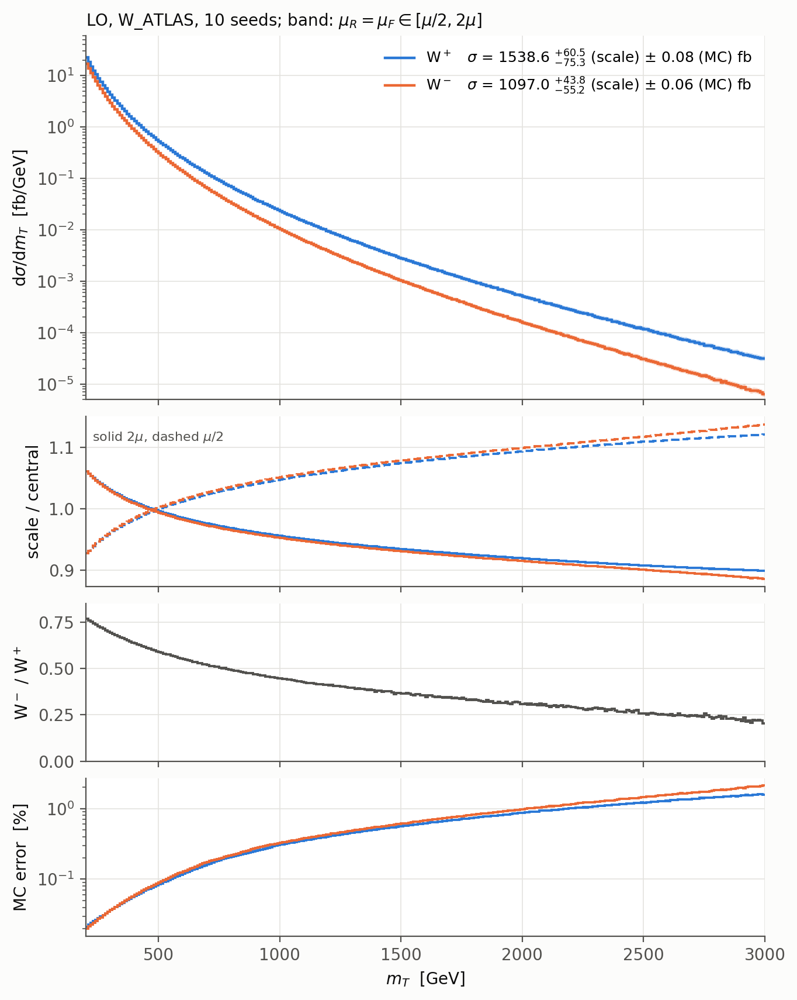
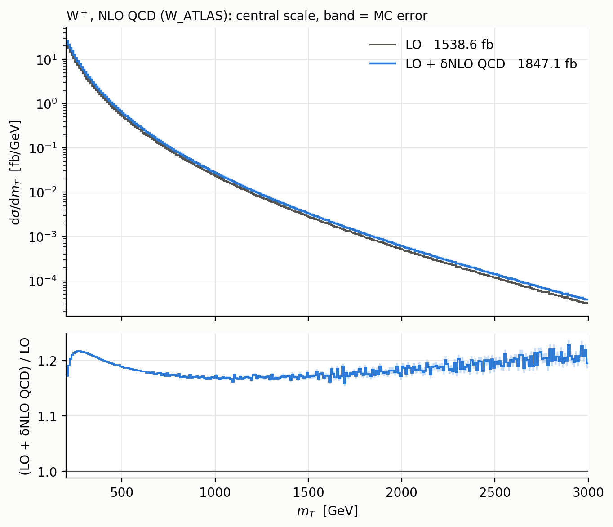
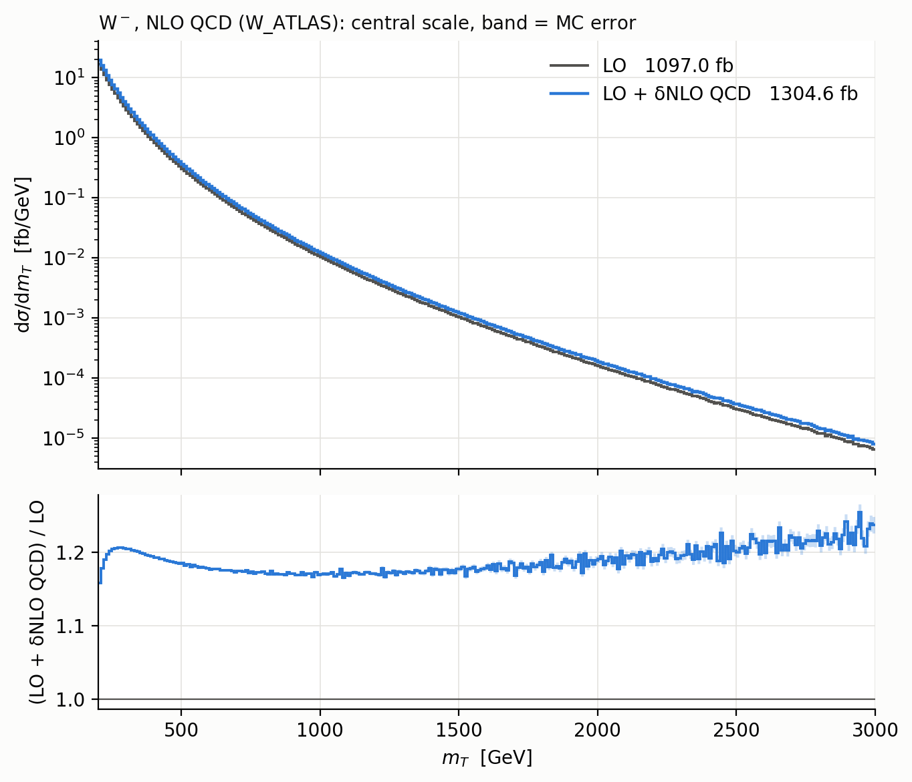
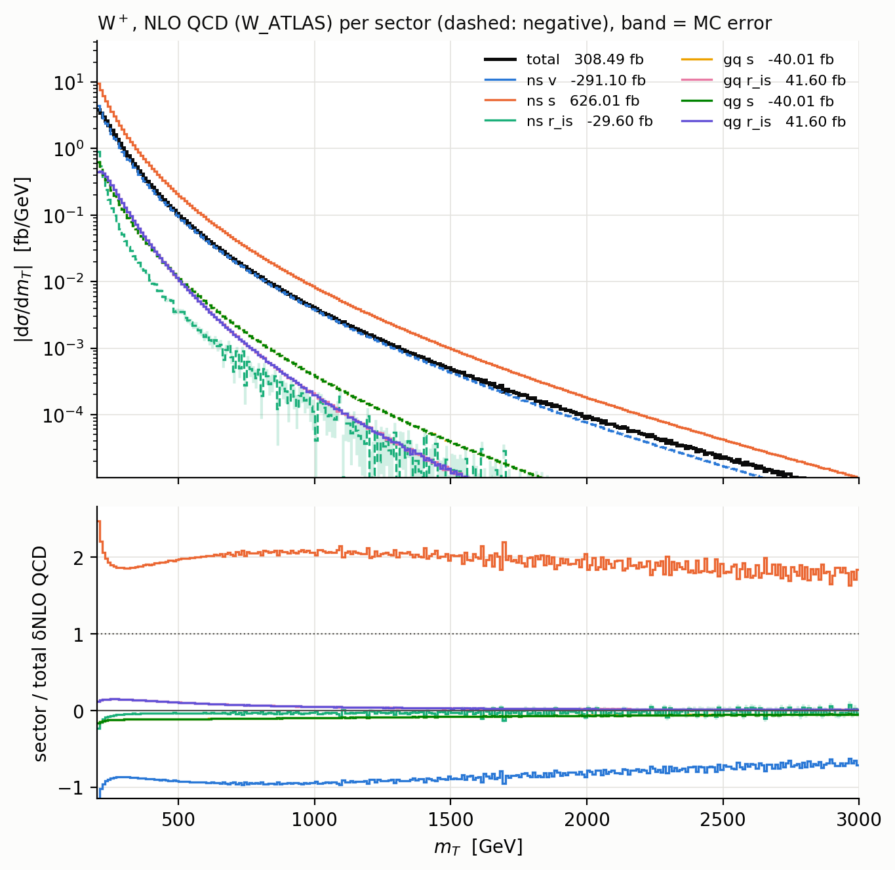
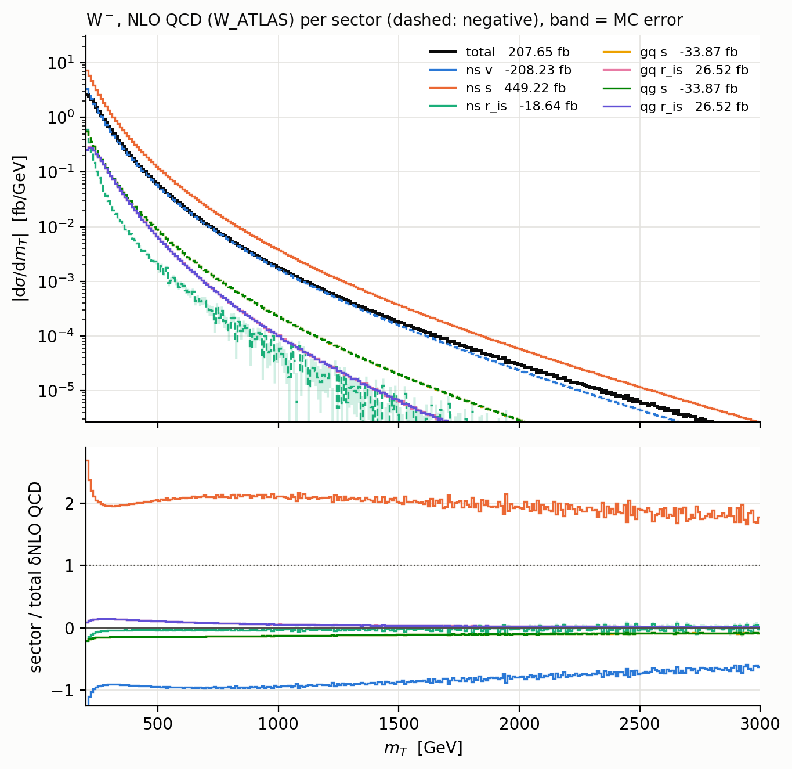

Consistency checks:
- LO seeds: spread 0.079 (W+) and 0.078 fb (W-) per seed, matching Vegas' error per seed (0.097, 0.063); the
  histogram error per seed is about 3 times larger (iterations combined in the histograms), so the histogram errors of
  the combined files are conservative. Warm-up agrees: 1538.2 ± 0.3, 1096.8 ± 0.2 fb.
- NLO QCD: histogram errors 1.2–2 times the seed-spread errors (W+ 0.023 against 0.018 fb). gq = qg to five digits
  (mirror), `ns r_is` from the seeds (−29.60 ± 0.02) agrees with its warm-up (−29.61). The sum is dominated by the
  cancellation `ns s` (+2 x total) against `ns v` (−0.9 x total): above 1.5 TeV the K factor scatters by 2–3% per bin.
- Scale: the band shrinks from LO (+3.9% / −4.9%) to NLO QCD (+0.9% / −0.3%); at LO only mu_F acts and the two
  variations cross at m_T ≈ 500 GeV (PDF evolution changes sign).
- Every histogram sums to the total rate; the 10 seeds of each sector read the same warm-up grid.

### B. Setup A: `W_incl`, 13 TeV, NNPDF4.0 QED (2026-11-25/26)

Settings: the `SETUP.md` setup A: `-ecoll 13000`, `NNPDF40_nnlo_as_01180_qed` (the defaults since 2026-11-25), analysis
`W_incl`: m_T > 200 GeV only (dressed lepton), histograms `rate`, `rate_window` (Phi(1–4)), `mT` (20 GeV to 1 TeV),
`mT_high` (100 GeV, 1–3 TeV), `mlnu`, `mlnu_high`, `ptl`, `yl`, `etal`, `ptlnu`, `costhCS`. Binary: git `72b48a8` plus
the `W_incl` changes committed in `668d178` (`bin/mixed_ll_a738e000`).

| Run | Sectors per boson | Warm-up | Production per seed | Seeds |
|---|---|---|---|---|
| LO | `lo ns na` | 10 x 10^6 | 5 x 10^7 | 10 |
| NLO QCD | `ns v`, `ns s`, `ns r_is`, `gq s`, `gq r_is`, `qg s`, `qg r_is` | 10 x 10^7 | 5 x 5·10^7 | 10 |

| Boson | sigma_LO(mu) | mu/2 | 2 mu | d sigma_NLO QCD(mu) | mu/2 | 2 mu |
|---|---|---|---|---|---|---|
| W+ | 2046.077 ± 0.062 | 1971.03 | 2102.69 | +441.063 ± 0.036 | +544.32 | +368.80 |
| W- | 1275.814 ± 0.027 | 1225.65 | 1313.55 | +269.804 ± 0.016 | +337.11 | +223.42 |

| Boson | sigma_LO+NLO QCD(mu) | mu/2 | 2 mu | K |
|---|---|---|---|---|
| W+ | 2487.140 ± 0.072 | 2515.35 (+1.13%) | 2471.49 (−0.63%) | 1.216 |
| W- | 1545.618 ± 0.031 | 1562.76 (+1.11%) | 1536.97 (−0.56%) | 1.211 |

Statistical error of LO + NLO QCD: LO and NLO errors in quadrature (independent runs), from the seed spread; from the
histogram errors (conservative) ± 0.117 (W+), ± 0.070 fb (W-). The mu/2, 2 mu values come from the same events.

| d sigma_NLO QCD [fb] | `ns v` | `ns s` | `ns r_is` | `gq s` | `gq r_is` | `qg s` | `qg r_is` |
|---|---|---|---|---|---|---|---|
| W+ | −388.5424 | 843.8917 | −23.7268 | −43.5381 | 48.2589 | −43.5386 | 48.2589 |
| W- | −242.8185 | 529.1993 | −13.1911 | −34.8232 | 33.1331 | −34.8235 | 33.1275 |

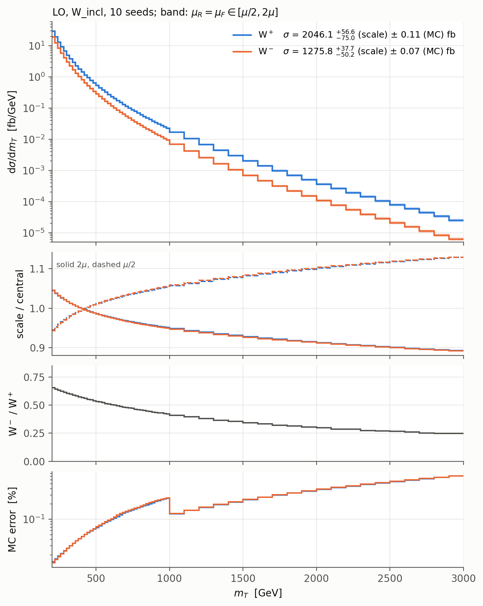
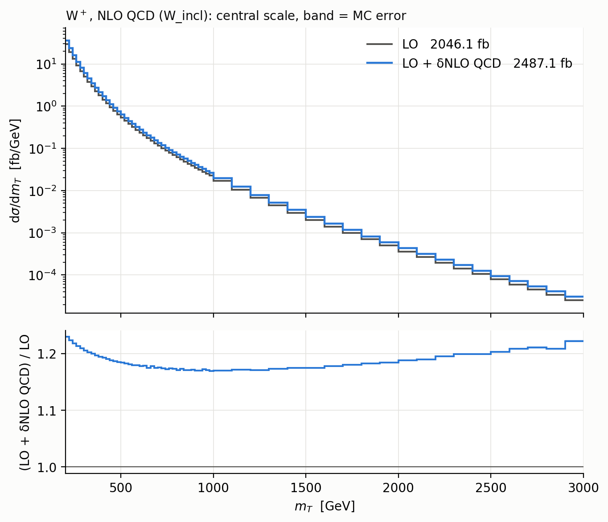
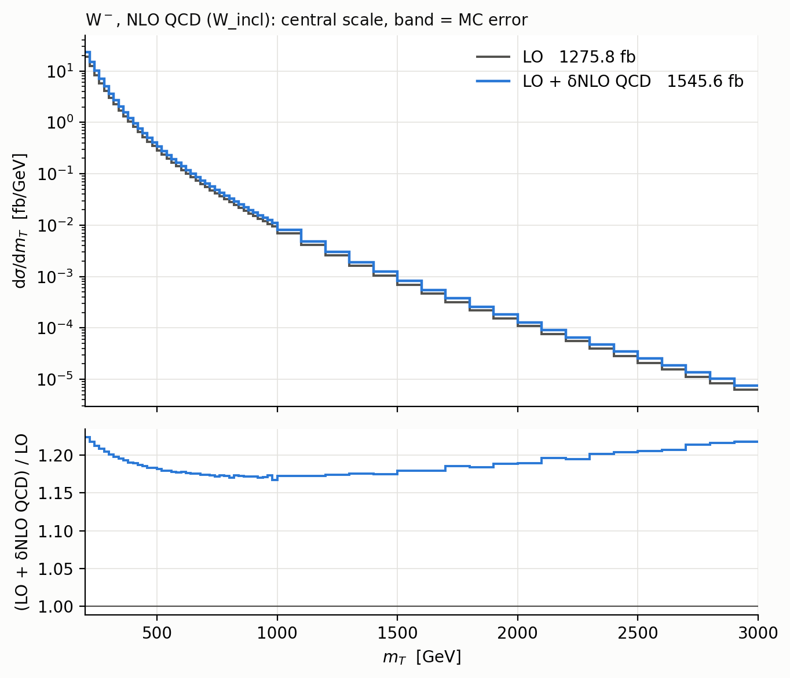
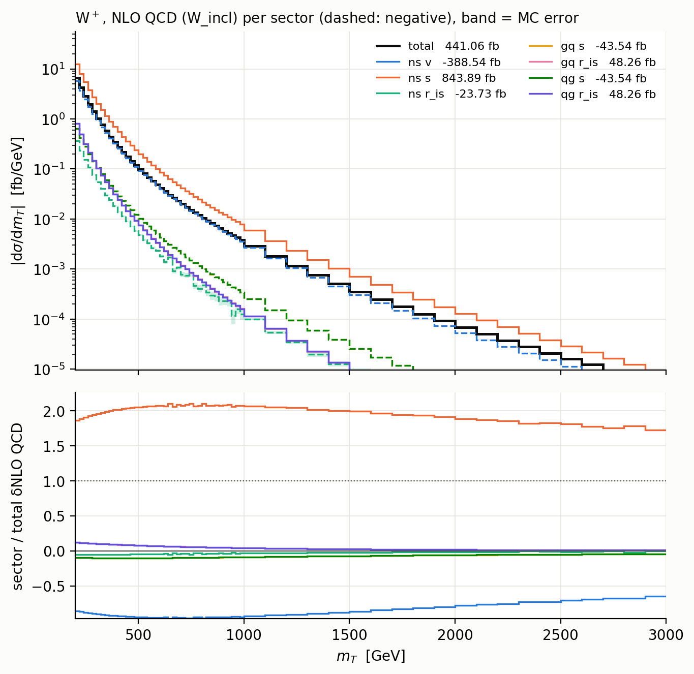
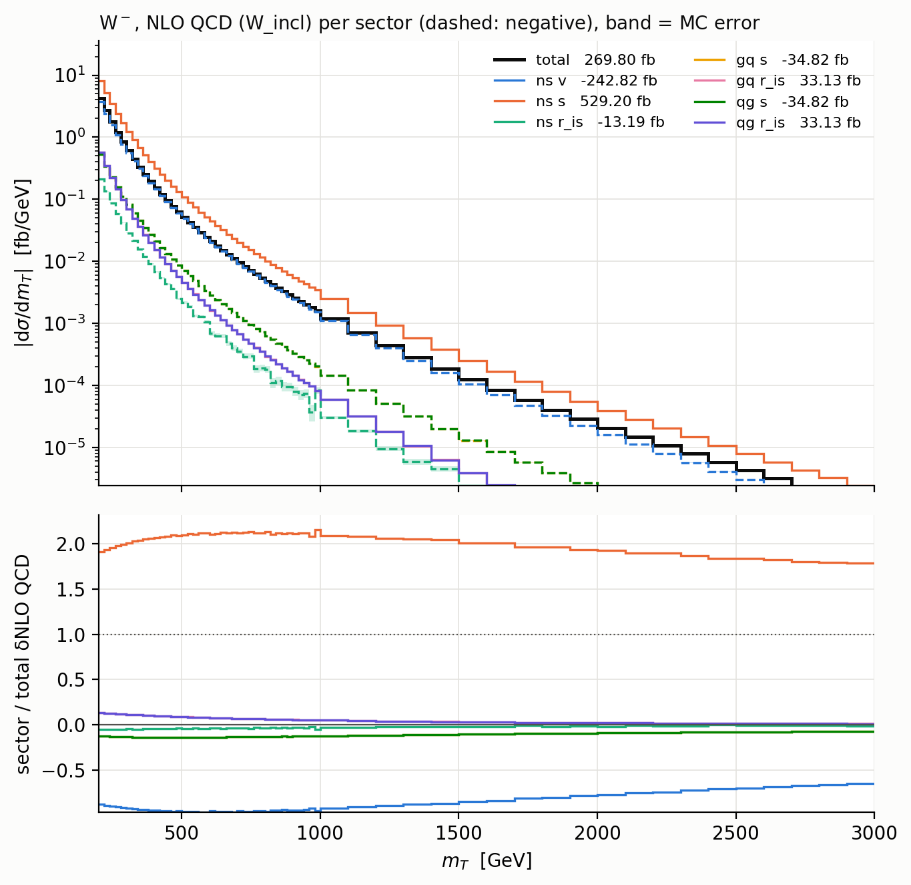

All observables of `W_incl`, LO and LO + NLO QCD with scale bands, ratio to LO (`cluster_KIT/plot_obs.py nloqcd --analysis
W_incl`): K = 1.22, 1.20, 1.18, 1.18 in the windows Phi(1–4); p_T,l starts at 100 GeV at LO (m_T > 200 GeV without
recoil), NLO fills below and K rises to 1.4 (W+), 1.6 (W-) at high p_T,l; y_l and eta_l nearly equal; p_T,lnu is a
single LO bin, its band (about ±20%) is the leading-order one; cos theta*_CS peaks at −0.25 (W+) and +0.25 (W-), the
mirror image expected from V−A with the charged lepton e+ / e-.

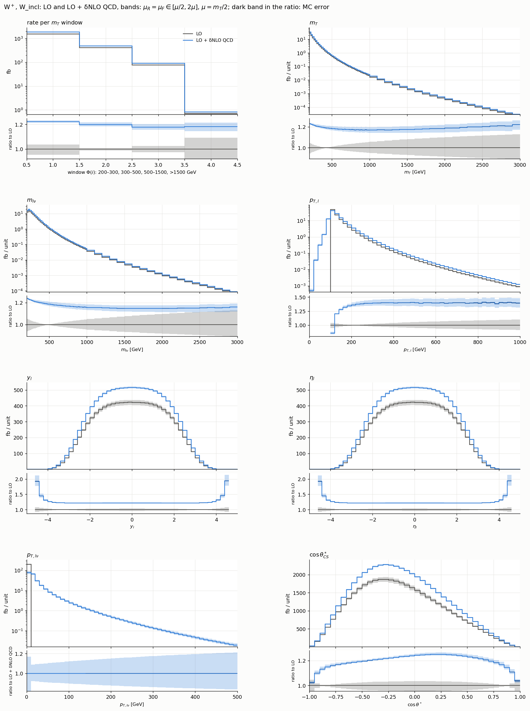
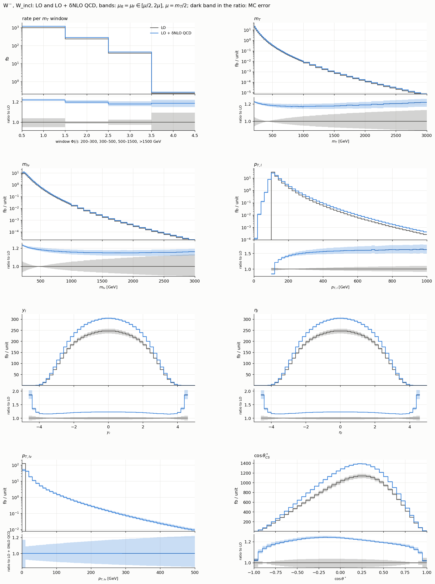

Consistency checks:
- Errors: LO seed spread 0.062 (W+), 0.027 fb (W-) against histogram 0.111, 0.067; NLO QCD seed spread 0.036, 0.016
  against histogram 0.037, 0.021. gq = qg to five or six digits (mirror).
- Histograms: every histogram (`rate_window`, `mT` + `mT_high`, `mlnu` + `mlnu_high`, `ptl`, `yl`, `etal`, `ptlnu`,
  `costhCS`) sums to the total rate; the 20 and 100 GeV m_T bins join continuously at 1 TeV; `ptlnu` is a single bin
  at LO. LO per window Phi(1–4): W+ 1554.08, 413.63, 77.67, 0.70 fb; W- 995.52, 241.59, 38.48, 0.22 fb.
- Scale: band LO +2.8% / −3.7% (W+), NLO QCD +1.1% / −0.6%; the LO variations cross at m_T ≈ 440 GeV.
- K factor: 1.23 at 200 GeV, 1.17 near 1 TeV, 1.22 at 3 TeV, smooth with the wider bins.
- Isolation from the running `W_ATLAS` jobs: grids, logs and histograms named after the analysis; the 34 `W_ATLAS` grids
  kept their checksums after the `W_incl` warm-ups (checked 2026-11-26).

#### NLO EW (`W_incl`, finished 2026-11-27)

Same settings and binary as LO and NLO QCD above (`bin/mixed_ll_a738e000`, histogram line `Git version:
72b48a8...-dirty`), partition empire, 10 seeds per sector:

| Sectors per boson | Warm-up | Production per seed | Time per seed |
|---|---|---|---|
| `ns v` | 10 x 10^6 | 5 x 2·10^7 | 31 h |
| `ns s`, `aq s`, `qa s` | 10 x 10^7 | 5 x 5·10^7 | 1.5–4.6 h |
| `ns r_is`, `ns r_fs_53`, `ns r_fs_54`, `aq r_is`, `qa r_is` | 10 x 10^7 | 5 x 4·10^7 | 3.7–7.8 h |

    PART=empire cluster_KIT/submit.sh <boson> nloewk <ch> <sec> 10 <Nc0> 10 <Nc1> 5
    python3 cluster_KIT/combine_nlo.py nloewk --analysis W_incl       # histo/comb_W_incl/nloewk_rates.md, plots
    python3 cluster_KIT/plot_obs.py nloewk --analysis W_incl          # all observables

| Boson | d sigma_NLO EW(mu) | mu/2 | 2 mu | d sigma / sigma_LO | sigma_LO+NLO QCD+NLO EW(mu) |
|---|---|---|---|---|---|
| W+ | −126.567 ± 0.002 | −124.10 | −127.72 | −6.19% | 2360.573 ± 0.072 |
| W- | −78.059 ± 0.002 | −76.38 | −78.86 | −6.12% | 1467.559 ± 0.031 |

Errors from the seed spread (histogram errors: ± 0.0045, ± 0.0027 fb). The last column adds LO, d NLO QCD and d NLO EW
(no mixed term).

| d sigma_NLO EW [fb] | `ns v` | `ns s` | `ns r_is` | `ns r_fs_53` | `ns r_fs_54` | `aq s` | `aq r_is` | `qa s` | `qa r_is` |
|---|---|---|---|---|---|---|---|---|---|
| W+ | −104.9302 | −7.0326 | −2.2525 | −4.1299 | −12.0260 | −0.0239 | 1.9262 | −0.0239 | 1.9261 |
| W- | −63.9465 | −4.3486 | −1.3346 | −7.9795 | −2.6241 | −0.0254 | 1.1125 | −0.0254 | 1.1125 |

d sigma_NLO EW / sigma_LO per window Phi(1–4): W+ −5.51%, −7.63%, −11.86%, −24.10%; W- −5.53%, −7.65%, −11.74%,
−23.94%. Per m_T bin (W+): −5.0% at 200 GeV, −9.9% at 500 GeV, −16.8% at 1 TeV, −26.2% at 2 TeV, −32.8% at 2.9 TeV.

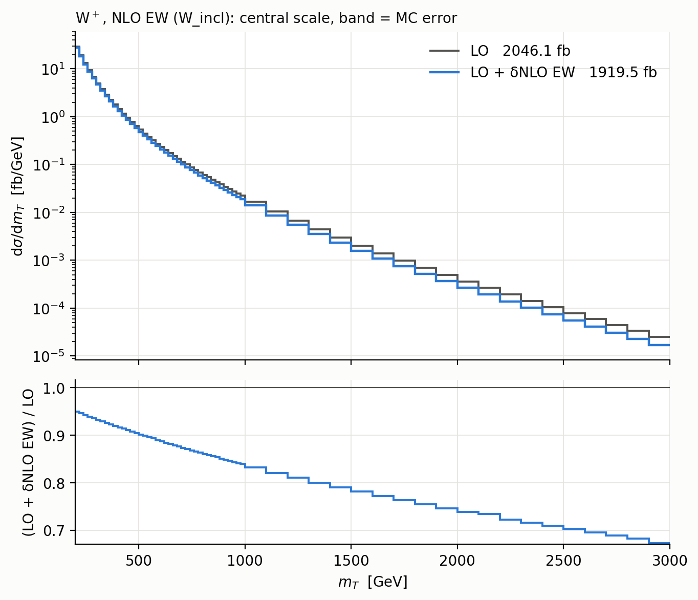
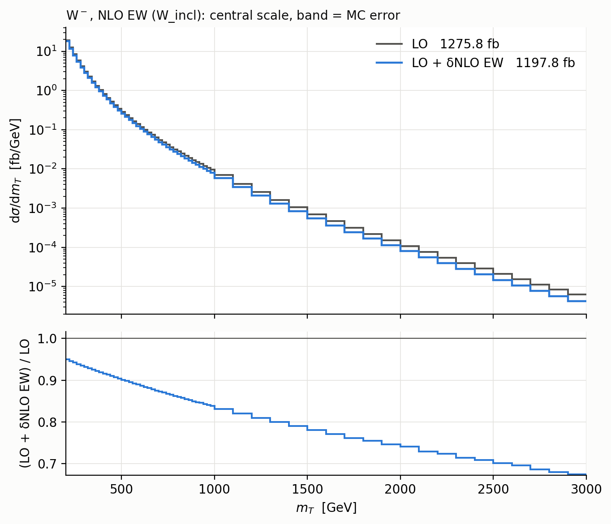
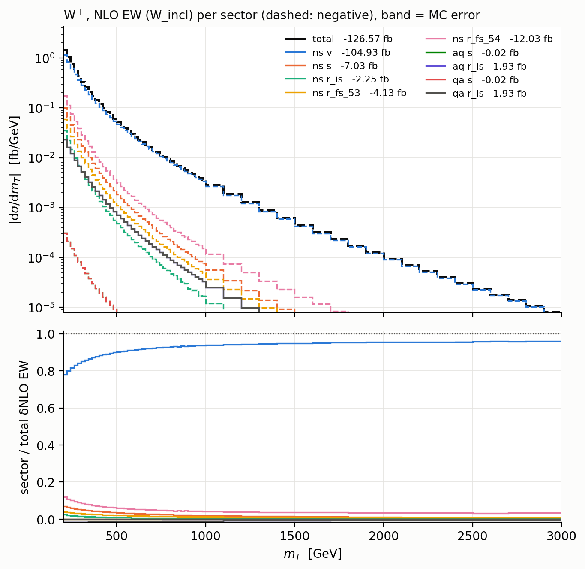
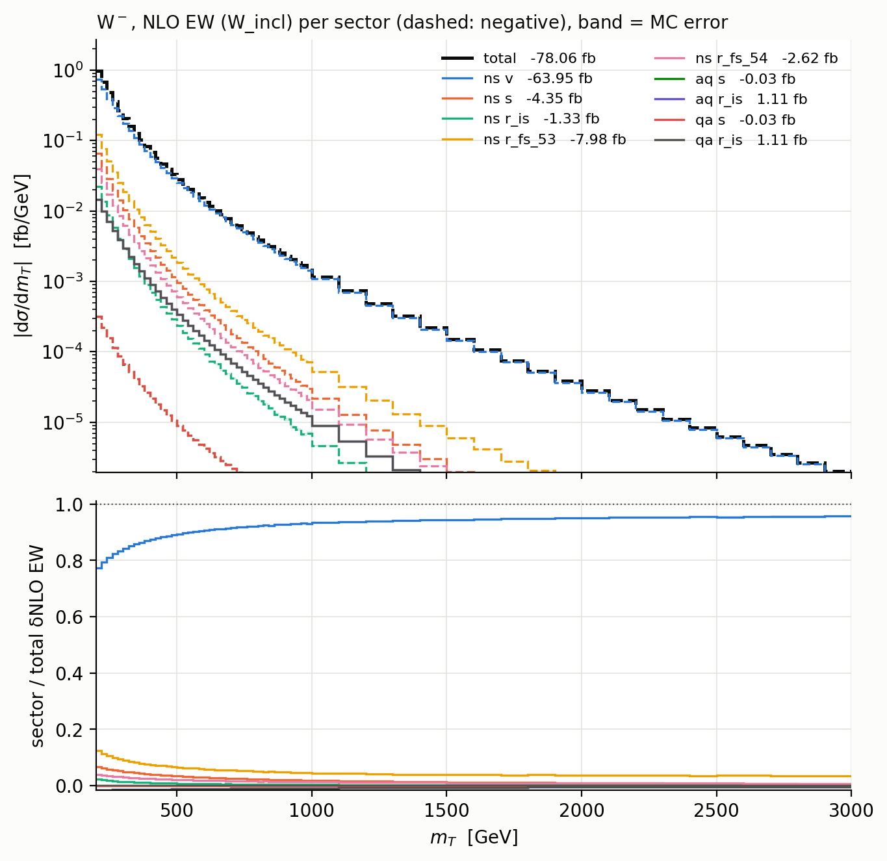
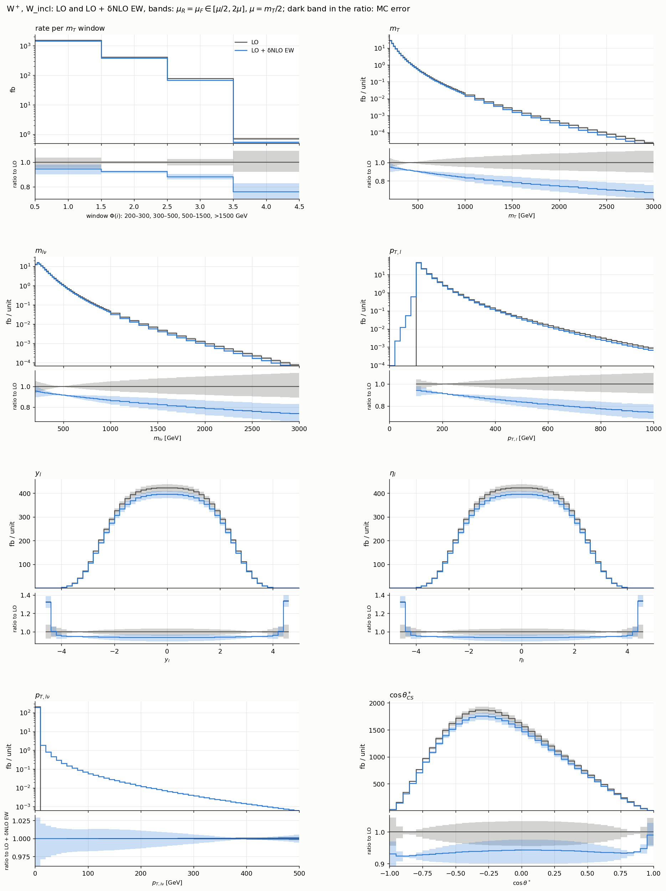
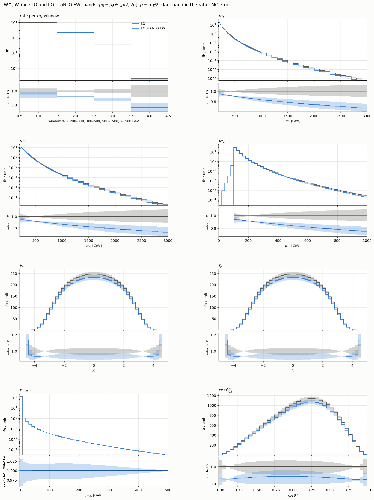

Consistency checks:
- Errors: seed spread 0.0023 (W+), 0.0015 fb (W-) against histogram 0.0045, 0.0027; per sector the seed spread is
  below or close to the histogram error (largest ratio 1.2, W- `r_fs_54`).
- Mirror symmetry: `aq` = `qa` to four or five digits (`r_is` 1.9262 / 1.9261, `s` −0.0239 / −0.0239).
- Final-state photon sector larger on the charged-lepton leg: `r_fs_54` (W+, e+ is leg 4) −12.03 against `r_fs_53`
  −4.13; `r_fs_53` (W-, e- is leg 3) −7.98 against `r_fs_54` −2.62.
- Histograms: every histogram sums to the total rate (W+ −126.567, W- −78.059 fb, within 10^-5 relative); `mT` and
  `mT_high` join at 1 TeV (d sigma_EW / d sigma_LO = −16.1% in 980–1000 GeV, −16.8% in 1000–1100 GeV).
- Scale: the correction changes by −1.9% / +0.9% (W+), −2.1% / +1.0% (W-) of itself, against the LO band +2.8% / −3.7%:
  nearly scale independent, as expected for an EW correction.
- Sudakov: the correction grows negative with m_T, from −5% at 200 GeV to −33% at 2.9 TeV, the same for W+ and W-.
- `ns v` dominates (83% of the total); `ns s` is small and of the same sign (−7.03, −4.35 fb), unlike NLO QCD where
  `ns v` and `ns s` cancel.
- Partial against complete `ns v`: 1–2 iterations gave W+ −104.9319, W- −63.9463 fb; complete −104.9302 ± 0.0039,
  −63.9465 ± 0.0023.
- Isolation: the 34 `W_ATLAS` grids keep their checksums (`md5sum -c grids_before.md5`, 34 OK, 2026-11-27).
- The seeds (5 iterations each) predate the histogram fix `299146b` (iterations averaged with the Vegas weights):
  totals unaffected, sparse bins in the distribution tails may be biased low; the same holds for LO and NLO QCD above.

NLO EW of `W_ATLAS`: `ns v` still running (2–3 of 5 iterations after 45 h on 2026-11-27).

### C. Setup B: `W_ATLASfid` against the ATLAS data (2026-11-27)

Data: ATLAS high-m_T charged-current Drell-Yan, arXiv:2502.21088, HEPData ins2895869, tables `lep_physical_plus_mtw`,
`lep_physical_minus_mtw` (e and mu combined, Born-level leptons, 140 fb^-1, 12 m_T bins from 200 GeV to 5 TeV), stored in
`data/hepdata_ins2895869/`. Data error: statistical and all systematic sources in quadrature (larger of up/down) and the
luminosity (0.83%). The same tables hold ATLAS's own prediction, which we only plot: DYTurbo NNLO QCD plus NLO EW
corrections without QED final-state radiation (MCsanc, additive; paper section 9), here with NNPDF4.0.

Settings: as setup A (13 TeV, `NNPDF40_nnlo_as_01180_qed`, mu = m_T/2, `-qmin 200`, `-qmin_rsc 20`, R_phot 0.1), analysis
`W_ATLASfid`: dressed p_T,l > 65 GeV, |eta_l| < 2.4, p_T,nu > 85 GeV, 200 < m_T < 5000 GeV; histogram `mT_ATLAS` has the
12 ATLAS bins. Separate build `f90_W_ATLASfid/` (a copy of `f90/` with `analysis=W_ATLASfid`, not in git), git `696c370`
(`bin/mixed_ll_d7f4b55e`), partitions sfb, form; one iteration per seed, 10 seeds:

| Run | Sectors per boson | Warm-up | Production per seed | Time per seed |
|---|---|---|---|---|
| LO | `lo ns na` | 10 x 10^6 | 1 x 5·10^7 | 0.2 h |
| NLO QCD | `ns v`, `ns s`, `ns r_is`, `gq s`, `gq r_is`, `qg s`, `qg r_is` | 10 x 10^7 | 1 x 2.5·10^8 | 0.4–2.5 h |

    cd f90_W_ATLASfid; PART=sfb,form cluster_KIT/submit.sh <boson> <corr> <ch> <sec> 10 <Nc0> 10 <Nc1> 1
    python3 cluster_KIT/plot_lo.py --analysis W_ATLASfid
    python3 cluster_KIT/combine_nlo.py nloqcd --analysis W_ATLASfid --its 1
    python3 cluster_KIT/plot_atlas.py          # histo/comb_W_ATLASfid/atlas_mT.png, atlas_mT.md

| Boson | sigma_LO(mu) | mu/2 | 2 mu | sigma_LO+NLO QCD(mu) | mu/2 | 2 mu | K | ATLAS | ATLAS DYTurbo |
|---|---|---|---|---|---|---|---|---|---|
| W+ | 1797.491 ± 0.028 | 1727.19 | 1851.46 | 2138.148 ± 0.038 | 2158.34 (+0.94%) | 2129.06 (−0.43%) | 1.190 | 2050.6 | 2058.1 |
| W- | 1061.331 ± 0.018 | 1014.91 | 1097.10 | 1260.666 ± 0.022 | 1272.26 (+0.92%) | 1256.34 (−0.34%) | 1.188 | 1225.1 | 1209.1 |

Cross sections in fb; errors from the seed spread. ATLAS totals are the sums over the 12 bins.

| LO + NLO QCD / data, m_T [GeV] | 200–250 | 250–300 | 300–350 | 350–425 | 425–500 | 500–600 | 600–750 | 750–900 | 900–1100 | 1100–1400 | 1400–2000 | 2000–5000 |
|---|---|---|---|---|---|---|---|---|---|---|---|---|
| W+ | 1.030 | 1.041 | 1.049 | 1.065 | 1.092 | 1.081 | 1.119 | 1.208 | 1.212 | 1.230 | 1.384 | 1.480 |
| W- | 1.021 | 1.029 | 1.044 | 1.053 | 1.036 | 1.064 | 1.064 | 1.063 | 1.017 | 1.145 | 1.191 | 1.336 |
| data error (W+) | 2.3% | 2.1% | 2.1% | 2.1% | 2.2% | 2.3% | 2.6% | 3.6% | 4.6% | 6.0% | 10.7% | 24% |

The ATLAS DYTurbo prediction is within 0–3% of the data up to 600 GeV. Without NLO EW our LO + NLO QCD lies 2–5% above
the data at low m_T and increasingly above at high m_T, about what the NLO EW correction of setup A (−5% at 200 GeV,
−17% at 1 TeV, −26% at 2 TeV) and NNLO QCD would remove. NLO EW for `W_ATLASfid` (9 sectors per boson, 10 seeds) was
submitted on 2026-11-27; it will be shown in full (dressed leptons) and without the final-state photon sectors `ns r_fs_53/54`,
which is closer to the Born-level data and to ATLAS's EW correction without QED final-state radiation.

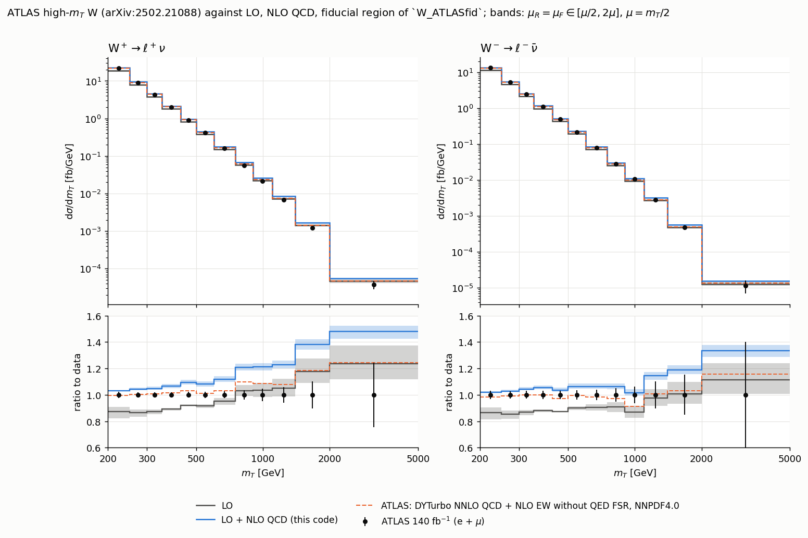
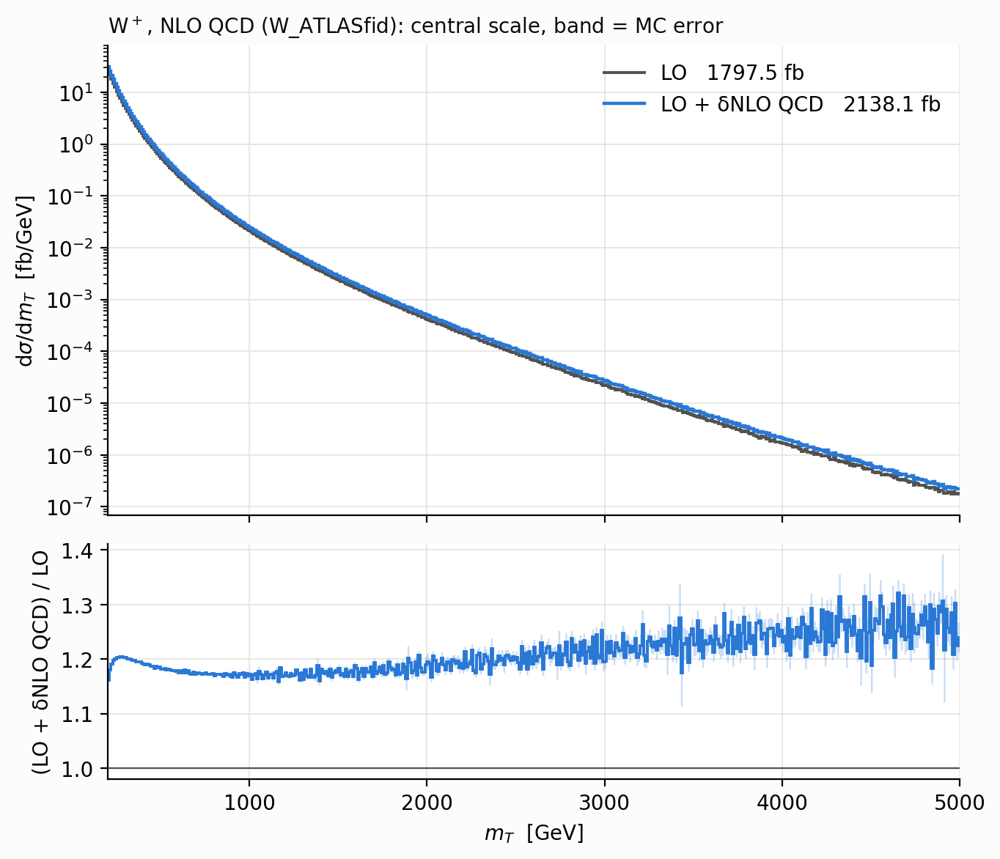
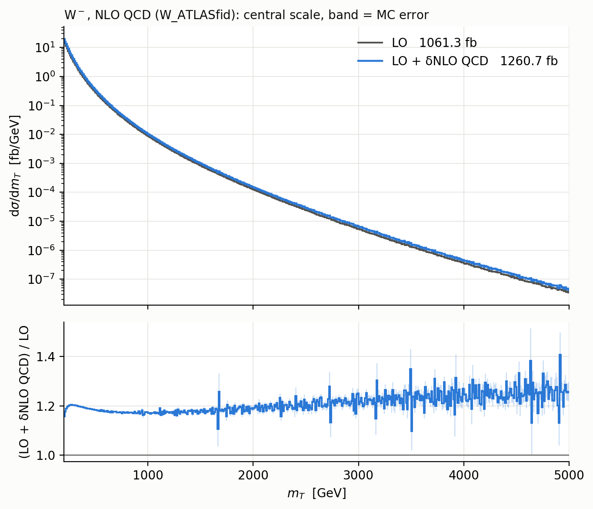

The comparison with ATLAS uses the 12 ATLAS bins (histogram `mT_ATLAS`); the two LO / NLO QCD plots use the 10 GeV
bins of histogram `mT` (same events, same totals).

Consistency checks:
- Errors: NLO QCD seed spread 0.025 (W+), 0.013 fb (W-) against histogram 0.039, 0.022.
- gq = qg: `s` −39.6163 both (W+), −32.2472 / −32.2473 (W-); `r_is` 33.8986 / 33.8922 (W+), 23.8328 / 23.8379 (W-),
  within the errors (0.006, 0.003).
- Histograms: every histogram sums to the total rate (to 10^-13 relative); the five |eta_l| histograms (one per m_T bin
  of ATLAS Table 1) add up to the rate between 200 and 2000 GeV.
- Acceptance of the fiducial cuts at LO: 87.9% (W+), 83.2% (W-) of setup A.
- K factor 1.19 for both bosons; `ns v` and `ns s` cancel to a large extent (−340.75 and +729.82 fb for W+), as in setup A.
- The ATLAS bin edges and the |eta_l| binning are those of HEPData (checked when the analysis was written).

### Planned: full NNLO run (`W_incl`, all channels)

All 111 sectors per boson (no VV, no `nf` pieces), 100 seeds per sector:
- warm-up 10 x 5·10^7, production 10 x 5·10^7 per seed: all RR sectors (every channel), `s_12`, `s_vqcd`,
  `s_oewk_fs_53/54` (84 sectors per boson);
- warm-up 10 x 5·10^6, production 10 x 5·10^5 per seed: the other 27 (RV, `s_vewk`, `s_oqcd`, `s_oewk_is`, photon-channel
  `s_oewk`, `s_qq`, `s_qqb`).

Cost from the cluster times of the small NNLO q qbar' run (2026-11-26; other channels scaled from a local timing test):
about 4,100 CPU-h of warm-up and 343,000 CPU-h of production, ≈ 348,000 CPU-h and 22,422 jobs for both bosons (≈ 38,000
CPU-h with 10 seeds); longest single job about 4 days (`ns_ga rr_5262c`, `rvewk_is`). To start after C4.9 (resolved).

## 12. NNLO QCD from the external code (`nnlo_qcd/`)

Goal: the NNLO QCD corrections for the ATLAS comparison (setup B, `W_ATLASfid`), computed with a separate code and added
to the mixed QCD x EW corrections of `f90/`. The two codes stay separate; what must match is the analysis, the PDF, the
EW input, the scales and the cuts.

Code: NNLO QCD for pp -> W+ -> e+ nu by R. Röntsch (`git.particle.kit.edu:roentsch/f90_wp`, branch `master`, commit
`e033944` of 2021-02-13, the only version), used with the authors' permission. Same framework as `f90/`: nested
soft-collinear subtraction; LO, NLO (`r`, `v`, `s`) and NNLO sectors (`vv`; `rv` in ns, qg, gq; `sub12`, `subv`,
`sub124` in ns, qg, gq, gg; RR sectors `rr4151a`...`rr4252d` in ns, qg, gq, s, gg); limit checks (`corr=limnlo`,
`limnnlo`). Aligned in 2021 with the mixed QCD x EW code of arXiv:2009.10386 (same EW parameters and histogramming).
Options as `key=value`: `corr`, `sec`, `ch`, `mu`, `xMuR`, `xMuF`, `vegasNc0/1`, `vegasIt0/1`, `seed`, `runname`,
`pdford`; output `histo/<runname>_<corr>[_<sec>][_<ch>]_xMuR_..._xMuF_....histo` in fb (histogram 17 = total rate).

As imported it differs from setup B:

| | `nnlo_qcd/` as imported | Needed (`W_ATLASfid`) |
|---|---|---|
| W boson | on shell, narrow width (`_PhaseSpaceType=6`) | off shell, 200 < m_T < 5000 GeV |
| Charge | W+ only | W+ and W- |
| EW input | M_W = 80.398, Gamma_W = 2.1054 GeV, G_F, real masses, fixed-width propagator | `SETUP.md`, complex-mass G_mu |
| PDF | `NNPDF31_nnlo_as_0118_luxqed` | `NNPDF40_nnlo_as_01180_qed` |
| Scale | fixed (`mu=`) | m_T/2 |
| Analysis | `Histograms/cut_histo_w.f90`, `fiducial = 0` (no cuts; 1 = arXiv:2009.10386; 4–6 = W-mass cuts) | `W_ATLASfid` cuts, ATLAS bins, our histogram format |

The tree amplitudes already contain the full W propagator and the phase space has a flat (off-shell) option; the loop
corrections at NNLO QCD act on the quark line only.

| Step | Status |
|---|---|
| 1. Import unchanged as `nnlo_qcd/` (`5a2bc34`, `nnlo_qcd/IMPORT.md`; working clone `nnlo_qcd_src/` not in git) | ✅ 2026-11-27 |
| 2. Build on ttpmarvin: `cd nnlo_qcd; mkdir -p objects modules histo; make Iam=ttpmarvin` (gfortran, LHAPDF 6.2.0; 24 s) (`caac068`) | ✅ 2026-11-27 |
| 3. Reproduce the published LO and NLO QCD numbers as imported; validate NNLO QCD | 🔧 LO, NLO done; NNLO open |
| 4. Adapt step by step, each a separate commit checked against `f90/` at LO and NLO QCD: off-shell phase space with `-qmin 200`, EW input and complex-mass scheme, NNPDF4.0, mu = m_T/2, W-, `W_ATLASfid` analysis and histogram format | ❌ |
| 5. NNLO QCD on the cluster for setup B; combine LO + NLO QCD + NNLO QCD + NLO EW + mixed QCD x EW; compare with ATLAS | ❌ |

Notes on the build: `gen_dump.script` regenerates `Histograms/dump_cut.f90`, `dump_const.f90`, `include_nobs.f90` at every
build (the imported ones were left from an older analysis with 6 histograms); every run writes the Vegas iteration log
`fort.15` in the working directory (no longer tracked). Run each job in its own directory with a `histo/` subfolder.

### Step 3: published numbers reproduced (2026-11-27)

pp -> W+ -> e+ nu, on-shell W, 13 TeV, `NNPDF31_nnlo_as_0118_luxqed` at all orders, mu_R = mu_F = M_W/2 = 40.199 GeV,
EW input of the code as imported. Inclusive: the code as imported (`fiducial = 0`). Fiducial: a scratch copy with
`fiducial = 1` (p_T,e > 15 GeV, p_T,miss > 15 GeV, |eta_e| < 2.4), not committed. Run on ttpmarvin: LO warm-up
5 x 10^5, production 5 x 10^6; NLO warm-up 5 x 2·10^5, production 3 x 2·10^6; the extra fiducial `r` seeds warm-up
5 x 5·10^5, production 1 x 5·10^6.

| Quantity | This code | Published | Difference |
|---|---|---|---|
| Inclusive sigma_LO | 8811.5 ± 1.4 pb | 8810 pb (arXiv:2103.02671 Table 1) | +1.1 sigma |
| Inclusive d sigma_NLO QCD | 2533.5 ± 1.8 pb (`r` 611.0 ± 1.5, `v` −2014.68 ± 0.29, `s` 3937.17 ± 0.85) | 2533 pb (arXiv:2103.02671 Table 1) | +0.3 sigma |
| Fiducial sigma_LO | 5193.9 ± 1.4 pb | 5195.0 pb (arXiv:2009.10386 Table 1) | −0.8 sigma |
| Fiducial d sigma_NLO QCD | 1138.5 ± 1.6 pb (`r` 85.97 ± 1.31 from 12 seeds, `v` −1187.67 ± 0.28, `s` 2240.20 ± 0.84) | 1137.0 pb (arXiv:2009.10386 Table 1) | +1.0 sigma |

All four agree with the published numbers within about one sigma (the papers quote no MC errors). Errors: Vegas
accumulated error of the production iterations (`fort.15`); for the fiducial `r` the plain mean of 12 seeds of one
iteration each (seed spread 4.5 pb, quoted error per seed 4.3 pb: the errors are reliable; the first run of 3 iterations
gave 86.7 ± 2.8 pb).

Reading the output: `Chisto17` in the log and the histogram file are rewritten after every iteration, warm-up included,
so a run is finished only when `fort.15` has all its lines (warm-up plus production iterations) and the process has
ended. (A first version of this table, commit `9fa9600`, quoted values read before the runs had finished: fiducial NLO
"1154 ± 8 pb, about 2 sigma high" and "the real-emission sector fluctuates by 25% per run" were artefacts of that.)

Neither paper gives an NNLO QCD number (arXiv:2009.10386 computes the mixed QCD x EW corrections and cites earlier work
for NNLO QCD; arXiv:2103.02671 uses them for the W mass). NNLO QCD validation plan:
1. the code's limit checks (`corr=limnnlo`) for every NNLO sector, as C1.5 for `f90/`;
2. an inclusive NNLO run on the cluster (about 30 sectors): scale dependence, stability across seeds;
3. an independent reference with the same input: DYTurbo or MATRIX, inclusive and fiducial.
